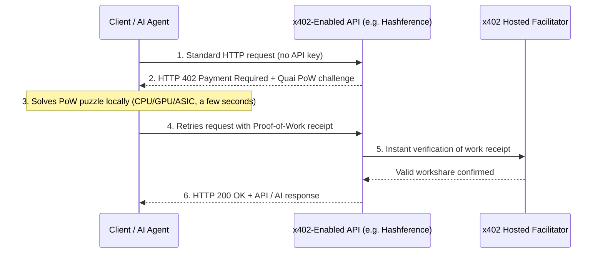

**x402 Work** and **Hashference** bring Quai Network's Energy-Based Money thesis directly to the web and AI agent economy—turning raw Proof-of-Work computation into instant, permissionless micropayments for HTTP requests.

<CardGroup cols={3}>
  <Card title="x402 Work Docs" icon="book" href="https://x402.qu.ai/docs">
    Full protocol specification, facilitator details, and integration guides.
  </Card>
  <Card title="Hashference" icon="microchip" href="https://hashference.com">
    Access 45+ frontier AI models via OpenAI & Anthropic-compatible APIs paid by compute, QUAI, or Qi.
  </Card>
  <Card title="Zero-Key Trial" icon="bolt" href="https://hashference.com/zero-key">
    Test live AI inference immediately using Proof-of-Work—no account, card, or wallet required.
  </Card>
</CardGroup>

## What Is x402 Work?

**x402 Work** is an open payment scheme built on the HTTP `402 Payment Required` status code. Instead of forcing human users or autonomous AI agents to register accounts, hold credit cards, or pre-fund crypto wallets with stablecoins, x402 Work lets any client pay for a web or API request by performing a few seconds of verifiable **Quai Network Proof-of-Work**.

### Why Proof-of-Work for Machine-to-Machine Payments?

- **Zero onboarding friction:** No KYC, no credit cards, no API key provisioning, and no pre-funded wallet required to start calling paid endpoints.
- **Native to AI agents:** Any machine running an AI agent already possesses compute (CPU, GPU, or ASIC) and electricity—allowing agents to convert compute directly into API access.
- **Real economic value for providers:** Each solved puzzle is valid Quai Network Proof-of-Work (supporting SHA-256d, Scrypt, or KawPoW profiles) verified via a hosted facilitator, so API providers require no local blockchain node setup.

### How the Request Flow Works



## Quickstart: Pay for an API Request with Proof-of-Work

Install the `x402-work-client` TypeScript/JavaScript package:

```bash
npm install https://x402.qu.ai/x402-work-client-0.1.0.tgz
```

Call an x402-enabled endpoint—such as Hashference's OpenAI-compatible chat completions API—without an API key:

```typescript
import { payWithWork } from "x402-work-client";

const body = {
  model: "claude-sonnet-4-5",
  messages: [{ role: "user", content: "Explain Quai Network's PoEM consensus in two sentences." }],
};

const { response } = await payWithWork(
  "https://hashference.com/x402/v1/chat/completions",
  body,
  { maxPrice: 500_000 } // Maximum proof-of-work cost you are willing to compute
);

const data = await response.json();
console.log(data);
```

When `payWithWork` receives an HTTP `402` challenge within your `maxPrice` threshold, it automatically computes the Proof-of-Work solution locally, attaches the work receipt, and retries the request.

## Hashference: AI Inference Powered by Quai

**[Hashference](https://hashference.com)** is the flagship service built on top of x402 Work. It provides unified, OpenAI- and Anthropic-compatible API access to **45+ frontier and open-source AI models** (including Claude, GPT, DeepSeek, and Llama families) with flexible payment modes:

- **Zero-Key Proof-of-Work (x402 Work):** Pay per request using your machine's compute—ideal for autonomous agents, scripts, and instant trials ([hashference.com/zero-key](https://hashference.com/zero-key)).
- **QUAI & Qi Payments:** Fund API usage directly with native Quai Network assets—tying AI compute consumption to [Energy-Based Money](/learn/tokenomics/flatcoins).
- **CLI & MCP Integration:** Built-in command-line tooling and Model Context Protocol (MCP) support so AI coding assistants and autonomous agents can discover and pay for inference natively.

## Next Steps

- Read the complete x402 Work protocol and server-side integration docs at [x402.qu.ai/docs](https://x402.qu.ai/docs).
- Try zero-key inference live at [hashference.com/zero-key](https://hashference.com/zero-key).
- Learn why energy is the natural unit of account for AI in [What Are Flatcoins?](/learn/tokenomics/flatcoins).
