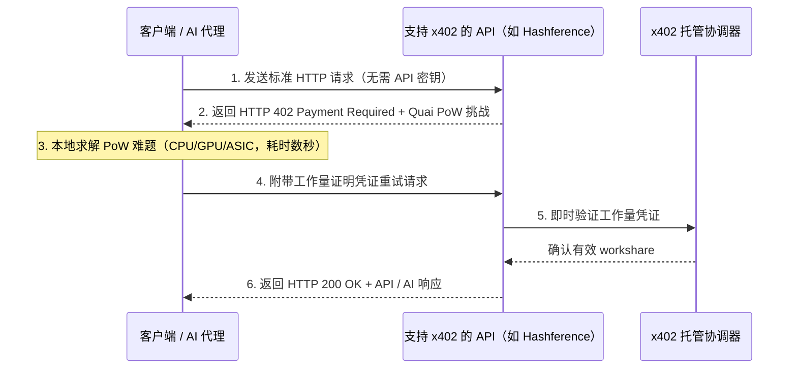

**x402 Work** 与 **Hashference** 将 Quai 网络的“基于能源的货币（Energy-Based Money）”理念直接引入 Web 与 AI 代理经济——将原始的工作量证明计算转化为面向 HTTP 请求的即时、无需许可的微支付。

<CardGroup cols={3}>
  <Card title="x402 Work 文档" icon="book" href="https://x402.qu.ai/docs">
    完整的协议规范、协调器（facilitator）详情与集成指南。
  </Card>
  <Card title="Hashference" icon="microchip" href="https://hashference.com">
    通过兼容 OpenAI 与 Anthropic 的 API 访问 45+ 前沿 AI 模型，支持使用算力、QUAI 或 Qi 支付。
  </Card>
  <Card title="零密钥试用" icon="bolt" href="https://hashference.com/zero-key">
    立即使用工作量证明体验实时 AI 推理——无需账号、银行卡或钱包。
  </Card>
</CardGroup>

## 什么是 x402 Work？

**x402 Work** 是一种构建在 HTTP `402 Payment Required` 状态码之上的开放支付方案。x402 Work 无需强制人类用户或自主 AI 代理注册账号、绑定信用卡或预先向加密钱包充值稳定币，而是允许任何客户端通过执行数秒可验证的 **Quai 网络工作量证明**，直接为 Web 或 API 请求付款。

### 为何将工作量证明用于机器对机器支付？

- **零上手门槛：** 无需 KYC、无需信用卡、无需申请 API 密钥，也无需预先充值钱包即可开始调用付费端点。
- **原生适配 AI 代理：** 任何运行 AI 代理的机器本身都具备算力（CPU、GPU 或 ASIC）与电力——使代理能够直接将算力转化为 API 访问权限。
- **为服务提供方带来真实经济价值：** 每一个求解完成的难题都是有效的 Quai 网络工作量证明（支持 SHA-256d、Scrypt 或 KawPoW 配置），并通过托管协调器完成验证，因此 API 提供方无需在本地搭建区块链节点。

### 请求流程如何运作



## 快速入门：使用工作量证明支付 API 请求

安装 `x402-work-client` TypeScript/JavaScript 包：

```bash
npm install https://x402.qu.ai/x402-work-client-0.1.0.tgz
```

无需 API 密钥，直接调用支持 x402 的端点（例如 Hashference 兼容 OpenAI 的对话补全 API）：

```typescript
import { payWithWork } from "x402-work-client";

const body = {
  model: "claude-sonnet-4-5",
  messages: [{ role: "user", content: "Explain Quai Network's PoEM consensus in two sentences." }],
};

const { response } = await payWithWork(
  "https://hashference.com/x402/v1/chat/completions",
  body,
  { maxPrice: 500_000 } // Maximum proof-of-work cost you are willing to compute
);

const data = await response.json();
console.log(data);
```

当 `payWithWork` 收到位于您的 `maxPrice` 阈值范围内的 HTTP `402` 挑战时，它会自动在本地计算工作量证明解、附加工作量凭证并重试请求。

## Hashference：由 Quai 驱动的 AI 推理平台

**[Hashference](https://hashference.com)** 是构建在 x402 Work 之上的旗舰服务。它为 **45+ 前沿与开源 AI 模型**（包括 Claude、GPT、DeepSeek 与 Llama 系列）提供兼容 OpenAI 与 Anthropic 的统一 API 访问，并支持灵活的支付方式：

- **零密钥工作量证明（x402 Work）：** 直接使用您设备的算力按次付费——非常适合自主代理、自动化脚本与即时试用（[hashference.com/zero-key](https://hashference.com/zero-key)）。
- **QUAI 与 Qi 支付：** 直接使用 Quai 网络原生资产为 API 用量充值，将 AI 算力消耗与[基于能源的货币](/cn/learn/tokenomics/flatcoins)紧密连接。
- **CLI 与 MCP 集成：** 内置命令行工具与 Model Context Protocol（MCP）支持，让 AI 编程助手与自主代理能够原生发现并支付推理服务费用。

## 下一步

- 在 [x402.qu.ai/docs](https://x402.qu.ai/docs) 阅读完整的 x402 Work 协议与服务端集成文档。
- 在 [hashference.com/zero-key](https://hashference.com/zero-key) 实时体验零密钥推理。
- 阅读[什么是平稳币（Flatcoin）？](/cn/learn/tokenomics/flatcoins)，了解为何能源是 AI 的天然记账单位。
