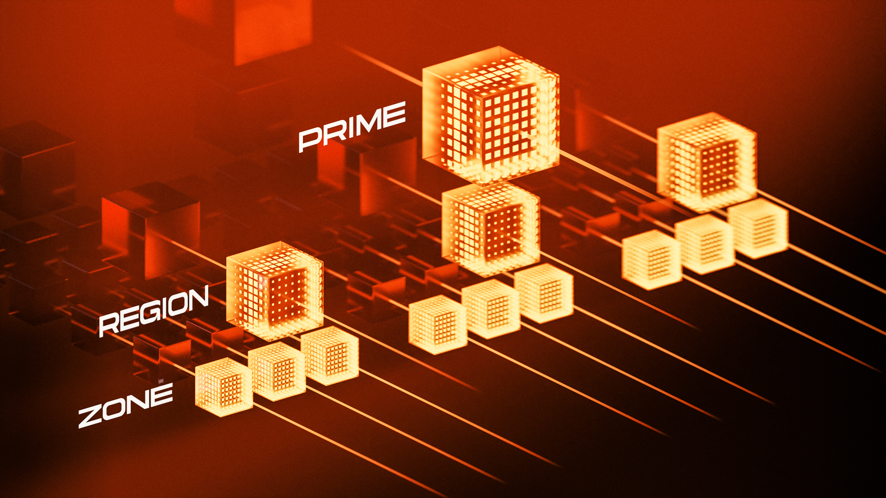

Quai 网络是一个下一代 Layer-1 区块链，将**工作量证明安全性**、**水平可扩展性**与**基于能源的货币**融为一体。

在其核心，Quai 汇聚了四项突破性创新：

- **[熵最小值证明（PoEM）](/cn/learn/advanced-introduction/poem/poem)与 Workshares：** 一种经过数学证明的 PoW 共识机制（相关 workshare 研究已获 **AFT 2026** 录用），能够消除区块竞争、抵御自私挖矿，并协调合并挖矿的执行层次结构。
- **硬通货价值存储（[QUAI](/cn/learn/tokenomics/quai-emissions) + [SOAP](/cn/learn/advanced-introduction/soap)）：** 兼容 EVM 的可编程硬通货——在 [Singularity 与 Polaris 分叉](/cn/learn/tokenomics/protocol-upgrades)后，流通供应占比已达 **~93%**，创世年通胀率 **&lt;4%**；并由 **SOAP 项目**强力加持，将外部 SHA-256、Scrypt 和 KawPoW 合并挖矿补贴持续转化为 100% QUAI 回购与销毁。
- **全球首个去中心化能源平稳币（[Qi](/cn/learn/tokenomics/flatcoins)）：** 基于 UTXO 的数字现金，其发行量直接随挖矿能源成本缩放——无需法币托管或外部价格预言机，即可保持实际购买力稳定。
- **面向 AI 与算力经济的原生支付通道（[x402 Work 与 Hashference](/cn/build/x402-and-hashference)）：** 开放的 HTTP 402 支付通道，使人类用户与自主 AI 代理能够直接通过数秒工作量证明、QUAI 或 Qi 支付 Web API 与前沿 AI 推理费用。

这些创新共同构建了一个面向全球人类商业与自主机器经济的去中心化货币与算力网络。

<CardGroup cols={2}>
  <Card
    title="释放 PoW 可扩展性"
    icon="arrow-up-right-dots"
    href="#释放可扩展性"
  >
    通过合并挖矿层次结构与 PoEM 共识，在全球规模下保持低廉的交易费用。
  </Card>
  <Card
    title="硬通货 + SOAP 引擎"
    icon="fire"
    href="/cn/learn/tokenomics/quai-emissions"
  >
    Singularity 与 Polaris 累计永久销毁 ~1.90B 创世 QUAI，并由持续的 PoW 回购提供支撑。
  </Card>
  <Card
    title="基于能源的平稳币（Qi）"
    icon="bolt"
    href="/cn/learn/tokenomics/flatcoins"
  >
    锚定物理能源成本的去中心化数字现金——而非持续贬值的法定货币。
  </Card>
  <Card
    title="AI 与机器支付（x402）"
    icon="microchip"
    href="/cn/build/x402-and-hashference"
  >
    无需钱包或 API 密钥，直接通过工作量证明支付 Web 请求与 45+ AI 模型推理费用。
  </Card>
</CardGroup>

<Frame>
  
</Frame>

## 释放可扩展性

**Quai 通过合并挖矿层次结构扩展执行容量，从而永久保持低廉的交易费用。**

将 Quai 想象成一个随着交通量增长而新增并行车道的高速公路系统。通过[熵最小值证明（PoEM）](/cn/learn/advanced-introduction/poem/poem)，Quai 在协调多条并行执行链（[执行分片](/cn/learn/advanced-introduction/poem/sharding/execution-sharding)）的同时，将完整的工作量证明安全性覆盖至整个层次结构。

主要优势：
- **动态扩展：** 网络随着需求增长扩展处理能力
- **低廉费用：** 并行执行避免单链式费用飙升
- **无信任互操作性：** 各分片通过[矿工验证的重合区块](/cn/learn/advanced-introduction/merged-mining/coincident-blocks)实现原生互联
- **多算法 PoW 安全性：** KawPoW 区块与 SHA-256、Scrypt workshares 相结合，使物理硬件安全来源跨越 ASIC 与 GPU 实现多元化

## 由工作量证明驱动的硬通货（QUAI + SOAP）

传统工作量证明区块链面临一种结构性矛盾：区块奖励用于保障网络安全，却也造成了持续的矿工抛压。Quai 通过 **[SOAP 项目](/cn/learn/advanced-introduction/soap)**（补贴式公开市场收购协议）与严格的供应纪律彻底扭转了这一局面：

- **Singularity 与 Polaris 分叉：** 从最初的 30 亿创世代币中永久销毁了 **~1.90B（约 19 亿）** 枚，将流通供应占比提升至 **~93%**，创世年通胀率降至 **&lt;4%/年**，并将剩余解锁缩减至 **~3.7M QUAI/月**（持续至 2029 年初）。
- **持续的 SOAP 回购与销毁：** 来自 Bitcoin Cash、Litecoin、Dogecoin 和 Ravencoin 的外部合并挖矿补贴流入协议控制的地址，在公开市场上买入 QUAI 并 **100% 永久销毁**。

随时访问 [supply.qu.ai](https://supply.qu.ai) 和 [soap.qu.ai](https://soap.qu.ai) 追踪实时供应、销毁与解锁指标。

## 基于能源的平稳币（Qi）

**与追踪贬值法币或依赖中心化银行托管的传统稳定币不同，[Qi](/cn/learn/tokenomics/flatcoins) 的稳定性源自物理能源成本。**

工作原理：
- 工作量证明挖矿充当无信任的链上[现实世界能源价格预言机](/cn/learn/tokenomics/token-dynamics/token-dynamics)
- 协议按挖矿难度线性缩放 [Qi 发行量](/cn/learn/tokenomics/qi-emissions)
- 矿工选择与[链上转换](/cn/learn/tokenomics/token-dynamics/conversions)动态平衡 Qi 供应量与真实需求

由于能源是人类经济活动与人工智能算力的共同基础投入，将[平稳币](/cn/learn/tokenomics/flatcoins)锚定于能源，便创造出面向以下场景的中立数字现金：
- **全球商业：** 抵御法币通胀与审查风险
- **AI 与算力经济：** 以驱动算力的核心资源为推理与机器服务定价
- **日常支付：** 具备类现金[隐私特性](/cn/learn/advanced-introduction/qi-privacy)的固定面额 UTXO

<Note>
**为什么这很重要**

传统区块链迫使用户在以下选项之间做出取舍：
- **工作量证明安全性**（比特币）或**智能合约可编程性**（以太坊）
- **去中心化**或**大规模低费用**
- **硬通货稀缺性**或**抗通胀数字现金**

Quai 在单一 Layer-1 上消除了这些权衡——融合了可扩展的 PoW、硬通货 QUAI、Qi 能源平稳币以及 PoW 原生的 AI 支付通道。
</Note>

## 准备好开始探索了吗？

<CardGroup cols={3}>
  <Card
    title="使用 Quai"
    icon="rocket"
    href="/cn/learn/use-quai"
  >
    钱包、交易所、Quainance DeFi、跨链桥接与实时工具。
  </Card>
  <Card
    title="Quai Explorer"
    icon="magnifying-glass"
    href="https://explorer.qu.ai"
  >
    查看主网区块、workshare、交易与智能合约。
  </Card>
  <Card
    title="供应仪表板"
    icon="chart-line"
    href="https://supply.qu.ai"
  >
    探索 Polaris 分叉后的实时供应、创世销毁与 SOAP 指标。
  </Card>
  <Card
    title="什么是平稳币？"
    icon="scale-balanced"
    href="/cn/learn/tokenomics/flatcoins"
  >
    了解 Qi 如何作为能源支持的平稳币保持购买力。
  </Card>
  <Card
    title="x402 Work 与 Hashference"
    icon="microchip"
    href="/cn/build/x402-and-hashference"
  >
    直接以工作量证明支付 AI 推理与 HTTP API 费用。
  </Card>
  <Card
    title="构建或挖矿"
    icon="code"
    href="/cn/build/introduction"
  >
    部署 EVM 合约、集成 Quais SDK 或运行 go-quai 节点。
  </Card>
</CardGroup>
