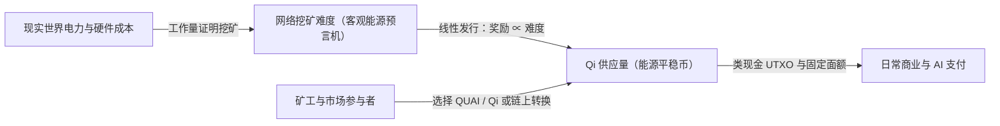

## 什么是平稳币（Flatcoin）？

**平稳币（Flatcoin）** 是一种旨在长期保持**实际购买力平稳**的加密货币，而非与美元等持续贬值的法定货币维持 1:1 挂钩。

这一术语在加密行业中广为流行（尤其是经由 Balaji Srinivasan 与 Coinbase Ventures 的推广），用以描述超越法币支持稳定币的下一代演进形态。传统稳定币将其名义价格固定在 `$1.00`，而平稳币的目标则是保持单位代币的*实际购买力*稳定——从而保护持有者免受货币贬值与通货膨胀的侵蚀。

<Note>
  **一句话区分稳定币与平稳币：** 美元稳定币追踪的是持续贬值的政府货币单位（`1 枚代币 = $1`，无论 `$1` 实际能买到什么）；而平稳币追踪的是现实世界的购买力（`1 枚代币 = 恒定的实际价值`）。
</Note>

## 为何法币稳定币存在局限

USDC 和 USDT 等法币支持稳定币解决了加密货币的短期价格波动问题，但它们从所映射的法币体系中继承了三大结构性缺陷：

1. **必然的购买力侵蚀：** 法定货币在设计上会随时间不断通胀。持有美元挂钩稳定币意味着承受 100% 的美元贬值，却无法获得发行方从储备国债中赚取的任何收益。
2. **中心化托管与审查风险：** 法币储备存放在受监管的银行账户与国库券中。发行方可以冻结地址、将交易列入黑名单，也可能面临合作银行破产的风险。
3. **主权货币依赖：** 当记账单位由单一中央银行控制时，法币稳定币就无法成为真正中立、无国界的货币，服务于全球商业或自主 AI 代理。

## 构建平稳币的三种路径

业界提出了多种构建抗通胀货币的设计方案，每种方案各有权衡：

| 设计方案 | 锚定机制 | 核心权衡 |
| :--- | :--- | :--- |
| **CPI / 通胀预言机平稳币** | 通过价格预言机与抵押金库追踪消费者物价指数（CPI）一篮子商品 | 依赖中心化的政府统计数据（CPI）、外部预言机及治理调整——重新引入了信任假设。 |
| **大宗商品 / RWA 支持平稳币** | 由代币化黄金、大宗商品或现实世界资产（RWA）篮子提供支持 | 需要实物托管机构、法律架构与链下审计；面临被查封与交易对手风险。 |
| **能源支持的 PoW 平稳币（[Qi](/cn/learn/tokenomics/qi-emissions)）** | 通过工作量证明按物理能源（挖矿难度）成比例直接发行 | **零托管机构、零价格预言机、零法币抵押。** 直接锚定热力学定律与电力市场。 |

## 为何能源是理想的货币锚定物

将货币锚定于物理能源——而非黄金储备或政治法令——拥有长达百年的思想渊源，从**亨利·福特（Henry Ford）**与**托马斯·爱迪生（Thomas Edison）**提出的“能源美元”构想，到**巴克敏斯特·富勒（Buckminster Fuller）**的“千瓦美元（Kilowatt Dollar）”。

能源作为平稳币的参考单位具有独特优势：
- **通用且可互换：** 一千瓦时电力在东京、奥斯汀与苏黎世具有完全相同的物理属性。
- **无法被政府人为操纵：** 没有任何中央银行能够印制焦耳，或改变热力学定律。
- **直接挂钩真实经济产出：** 每一件实体商品、制造流程以及每一单位 **AI 算力**都以能源作为首要投入。在一个日益由数据中心和自主 AI 代理驱动的经济体中，能源*本身就是*最根本的记账单位。

## Qi 如何作为去中心化能源平稳币运作

**Qi**（发音为 *"chee"*，源自代表能量或生命力的中文字符“气”）是 Quai 网络的原生能源支持平稳币，与 [QUAI](/cn/learn/tokenomics/quai-emissions)（Quai 的稀缺硬通货价值存储代币）并行运作。

### Qi 的核心特性
- **工作量证明即无信任能源预言机：** Quai 协议不依赖链下 CPI 数据源，而是将挖矿难度作为现实世界能源消耗的直接、防篡改代理指标。Qi 区块奖励随难度**线性**缩放，从而使每一枚 Qi 在长期内代表一致的物理能源单位。
- **零预挖 / 零创世供应：** Qi 启动时初始供应量为 **0**。流通中的每一枚 Qi 均仅通过工作量证明挖矿或协议级 [QUAI ↔ Qi 转换](/cn/learn/tokenomics/token-dynamics/conversions)进入市场。
- **需求响应型供应：** 与固定上限的价值存储资产（需求变化会导致价格剧烈波动）不同，Qi 的供应量会通过矿工奖励选择和链上转换，在需求上升时扩张、需求下降时收缩——从而通过供应量而非价格来吸收需求冲击。
- **原生类现金隐私设计：** Qi 构建在采用固定面额与不可复用地址的 UTXO 账本之上（[Qi 隐私](/cn/learn/advanced-introduction/qi-privacy)），兼具实体数字现金的特性，且不存在中心化冻结开关。

## 货币模型对比

| 特性 | 法币稳定币（USDC/USDT） | 算法稳定币 | CPI 预言机平稳币 | **Qi（Quai 能源平稳币）** |
| :--- | :--- | :--- | :--- | :--- |
| **价值锚定** | 美元（法币） | 反身性代币挂钩 | 政府 CPI 篮子 | **现实世界能源（PoW 难度）** |
| **抗通胀保护** | 无（跟随美元贬值） | 不稳定 / 脱锚风险 | 取决于 CPI 准确性 | **锚定物理能源成本** |
| **抵押品 / 托管方** | 中心化银行与国库券 | 内生 / 脆弱 | 超额抵押金库 | **无（原生 PoW 发行）** |
| **预言机依赖** | 链下银行审计证明 | 市场价格预言机 | CPI + 价格预言机 | **无（难度原生位于链上）** |
| **抗审查能力** | 低（发行方冻结密钥） | 中 | 中 | **高（去中心化 PoW + UTXO 隐私）** |
| **面向 AI 与算力** | 需要 KYC / 银行通道 | 脆弱 | 复杂的 DeFi 封装 | **原生适配 PoW 与 [x402 Work](/cn/build/x402-and-hashference)** |

## 双代币协同：平稳币 + 硬通货

单一平稳币的设计目标是保持购买力，而非作为增值储备资产来捕获网络增长价值。这正是 Quai 将 **Qi** 与 **[QUAI](/cn/learn/tokenomics/quai-emissions)** 配对的原因：

- **QUAI** 捕获长期网络增长与稀缺性价值（在 [Polaris 分叉](/cn/learn/tokenomics/protocol-upgrades)之后，流通比例约 ~93%，创世年通胀率 &lt;4%，并通过 [SOAP](/cn/learn/advanced-introduction/soap) 持续销毁）。
- **Qi** 提供锚定能源的平稳币，适用于稳定定价、日常数字现金及机器对机器的算力支付。
- **链上转换**在协议层面直接连通两种资产，无需中心化桥接或托管发行方。

## 继续探索

<CardGroup cols={2}>
  <Card title="Qi 发行" icon="bolt" href="/cn/learn/tokenomics/qi-emissions">
    深入了解 Qi 与难度成正比的线性发行公式及供应机制。
  </Card>
  <Card title="代币动态与转换" icon="arrows-rotate" href="/cn/learn/tokenomics/token-dynamics/conversions">
    了解矿工与用户如何在链上进行 QUAI 与 Qi 之间的转换。
  </Card>
  <Card title="实时转换仪表板" icon="chart-line" href="https://conversions.quai.network/">
    查看实时的 QUAI ↔ Qi 转换汇率。
  </Card>
  <Card title="实时供应仪表板" icon="gauge-high" href="https://supply.qu.ai">
    在 supply.qu.ai 上实时追踪 QUAI 和 Qi 的供应指标。
  </Card>
</CardGroup>
