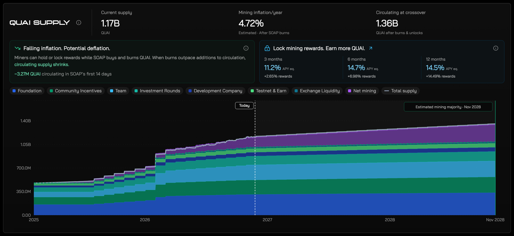
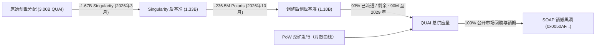
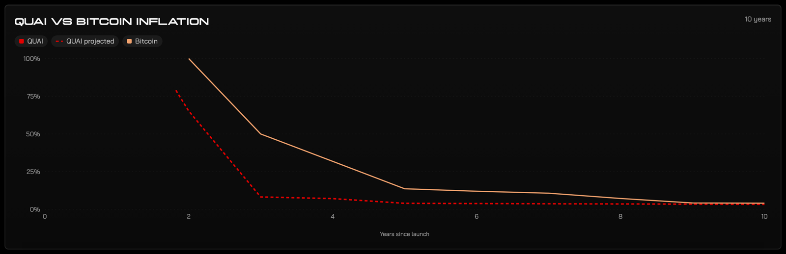
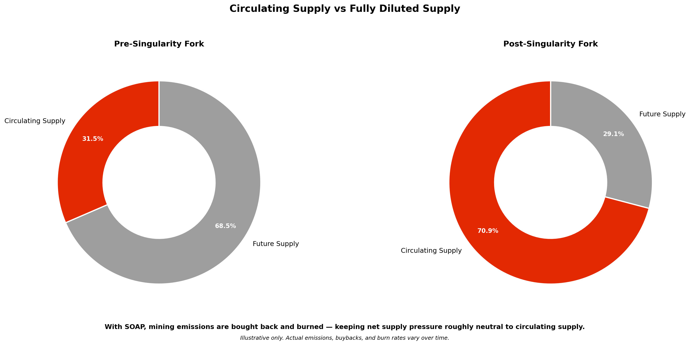

## 发行概览

QUAI 的供应演变遵循一条单一而透明的公式：

$$
\text{Total Supply} = \text{Genesis Unlocks} + \text{Mining Emissions} - \text{SOAP Burns}
$$

三大协议里程碑共同塑造了 QUAI 的硬通货供应轨迹：

- **[Singularity 分叉](/cn/learn/tokenomics/protocol-upgrades)（2026 年 3 月，`go-quai v0.51.0`）：** 通过投资者、Dominant Strategies 与 Quai 基金会的联合协议，永久销毁 **1,667,159,984 QUAI**（占未来创世解锁的 81.1%），将既定创世基准从 **3,000,000,000 QUAI** 降至 **1,332,840,016 QUAI**。
- **[Polaris 分叉](/cn/learn/tokenomics/protocol-upgrades)（2026 年 10 月，`go-quai v0.57.0`）：** Quai 创始人与 Dominant Strategies 团队永久销毁其剩余未来创世分配中的额外 **236,456,538 QUAI**——使累计创世销毁达到 **1,903,616,522 QUAI（~1.90B）**，并将调整后的创世基准进一步降至 **1,096,383,478 QUAI**。
- **[SOAP 项目](/cn/learn/advanced-introduction/soap)（2025 年 12 月至今）：** 将 100% 的外部合并挖矿工作量证明补贴（BCH、LTC、DOGE、RVN）路由至持续的公开市场 QUAI 回购，并 **100% 永久销毁**——迄今已销毁超过 **254.6M QUAI**。

<Frame caption="来自 supply.qu.ai 的 Polaris 后实时 QUAI 供应状态与核心催化剂（2026 年 11 月）">
	
</Frame>

<CardGroup cols={3}>
  <Card title="实时供应仪表板" icon="chart-line" href="https://supply.qu.ai">
    在 supply.qu.ai 上实时追踪流通供应量、创世销毁、挖矿发行与解锁时间表。
  </Card>
  <Card title="SOAP 销毁仪表板" icon="fire" href="https://soap.qu.ai">
    实时监控合并挖矿补贴流入以及累计 QUAI 回购与销毁数据。
  </Card>
  <Card title="浏览器上的销毁地址" icon="magnifying-glass" href="https://explorer.qu.ai/address/0x0050AF0000000000000000000000000000000000">
    通过 explorer.qu.ai 在链上验证永久销毁的 QUAI。
  </Card>
</CardGroup>

## Polaris 分叉后供应快照

Polaris 分叉（于 2026 年 10 月 13 日激活；更新后的解锁时间表于 10 月 30 日截止后生效）消除了长期的内部解锁抛压，加速了 QUAI 向成熟、供应受限的硬通货资产转型：

| 指标 | Polaris 前（Singularity 后） | Polaris 后（当前） |
| :--- | :--- | :--- |
| **原始创世分配** | 3,000,000,000 QUAI | 3,000,000,000 QUAI |
| **累计创世销毁** | 1,667,159,984 QUAI | **1,903,616,522 QUAI（~1.90B）** |
| **调整后创世基准** | 1,332,840,016 QUAI | **1,096,383,478 QUAI** |
| **流通供应占比** | ~77% | **~92.8%（1.17B QUAI）** |
| **年度创世通胀率** | ~13% / 年 | **&lt; 4% / 年** |
| **净挖矿通胀率（扣除 SOAP 销毁）** | — | **~4.72% / 年** *（估算）* |
| **总网络通胀率（含 SOAP）** | ~18% / 年 | **&lt; 9% / 年** |
| **月度创世解锁量** | ~13M QUAI / 月 | **~3.7M QUAI / 月** *（约占流通量 0.32%；2027 年 5 月起降至 3.6M）* |
| **剩余锁定创世量** | ~327M QUAI | **~90.4M QUAI（7.2%）** *（2029 年初全部归属完毕）* |
| **累计 SOAP 销毁量** | — | **254.6M+ QUAI** |

<Frame caption="Polaris 后 QUAI 供应轨迹及预计 2028 年 11 月实现挖矿主导（supply.qu.ai）">
	
</Frame>

<Note>
  如需查看实时流通供应量、累计 SOAP 销毁量与每日发行明细，请始终以 [supply.qu.ai](https://supply.qu.ai) 为准。如需逐次分叉的完整解析，请参阅[协议升级与分叉](/cn/learn/tokenomics/protocol-upgrades)。
</Note>

**硬通货轨迹：** 随着剩余创世解锁逐步结束（约 ~3.7M QUAI/月，直至 2029 年初完全归属），且 SOAP 回购不断抵消挖矿发行，净供应增长趋近于零——每当 SOAP 销毁量超过新挖出的 QUAI 时，网络即可进入净通缩状态。

## 重新思考代币发行

传统加密货币使用基于固定时间的发行时间表，比特币的 2100 万枚上限就是最著名的例子。虽然可预测，但僵化的时间表无法响应不断变化的需求或算力，可能会放大繁荣与萧条周期。

对于价值存储代币而言，持久的价值创造要求供应增速持续低于网络采用增速。Quai 不再仅仅依赖人为设定的日历节点，而是结合了三大机制：

- **对数挖矿发行：** QUAI 区块奖励随网络难度增长呈反向缩放，在算力与采用率扩张时自然放缓发行速度。
- **双代币灵活性：** 矿工可自主选择赚取 [QUAI](/cn/learn/tokenomics/quai-emissions)（稀缺价值存储）或 [Qi](/cn/learn/tokenomics/qi-emissions)（能源支持的[平稳币](/cn/learn/tokenomics/flatcoins)），动态平衡稀缺性与支付流动性。
- **SOAP 公开市场销毁：** 外部工作量证明补贴持续在公开市场买入并销毁流通中的 QUAI，形成与需求挂钩的永久供应吸收机制。

## 网络价值理论与发行设计

网络系统通常经历两个增长阶段：
- **早期阶段：** 由网络效应驱动的快速 $n^2$ 扩张
- **成熟阶段：** 由效率提升驱动的稳健 $n \log(n)$ 扩张

Quai 的自适应挖矿发行与真实网络状况（算力、难度与使用量）保持一致，带来三大优势：
- **自适应供应：** 协议发行直接响应挖矿难度与市场需求。
- **高效分配：** 资本与安全奖励流向最具生产力的环节。
- **减少供应冲击：** 受控、透明的发行曲线避免了破坏性的集中释放悬崖。

## QUAI 发行分配与对比比特币通胀曲线

QUAI 旨在收敛为一种公平、由挖矿驱动的硬资产。在 Singularity 与 Polaris 分叉中永久销毁了 **~1.90B（约 19 亿）** 枚创世代币，且目前 **~92.8%** 的供应已经流通后，累计工作量证明挖矿奖励预计将在 **2028 年 11 月** 超过已解锁创世分配（交叉点流通量约 ~1.36B QUAI），并在 2030 年底前达到总发行量的 **~62.6%**（扣除 SOAP 销毁前）。

<Frame caption="10 年通胀轨迹对比：QUAI（Polaris + SOAP 后）vs. 比特币（supply.qu.ai）">
	
</Frame>

如需查看流通供应量、创世解锁、锁仓挖矿 APY 与 SOAP 销毁的实时动态图表，请访问 [supply.qu.ai](https://supply.qu.ai)。

## SOAP 回购与销毁

随着 [SOAP 项目](/cn/learn/advanced-introduction/soap)的激活，来自外部工作量证明父链（BCH、LTC、DOGE、RVN）的合并挖矿补贴通过 AuxPoW 承诺在协议层面路由至协议控制的地址，在公开市场上兑换为 QUAI，并 **100% 永久销毁**。

在实践中：
- 外部链补贴通过 AuxPoW workshare 承诺在协议层捕获。
- 这些补贴在公开市场上持续买入 QUAI。
- 所购 QUAI 的 **100%** 被发送至销毁地址（[`0x0050AF0000000000000000000000000000000000`](https://explorer.qu.ai/address/0x0050AF0000000000000000000000000000000000)），永久减少流通供应量。

如需了解完整的技术设计（workshares、AuxPoW 验证、委员会治理与奖励流向），请继续阅读 [SOAP 项目](/cn/learn/advanced-introduction/soap)。如需实时销毁指标，请访问 [soap.qu.ai](https://soap.qu.ai) 和 [supply.qu.ai](https://supply.qu.ai)。

<Frame>
	
</Frame>

<AccordionGroup>
<Accordion title="历史创世基准（Singularity / Polaris 分叉前）">

在 **Singularity 分叉**（2026 年 3 月）与 **Polaris 分叉**（2026 年 10 月）之前，Quai 启动时的初始既定创世基准为 **3,000,000,000 QUAI**。通过两次累计达 **1,903,616,522 QUAI** 的协议级销毁，该基准被永久降至 **1,096,383,478 QUAI**。

<Frame>
	
</Frame>

<Note>
  上图反映的是首次 **Singularity 分叉**的削减幅度（3.00B → 1.33B）。随后的 **Polaris 分叉**进一步销毁了创始人与 Dominant Strategies 剩余解锁中的 **236,456,538 QUAI**，将调整后的创世基准降至 **1,096,383,478 QUAI**。请访问 [supply.qu.ai](https://supply.qu.ai) 查看 Polaris 分叉后的实时图表。
</Note>

### 原始启动解锁时间表（已被 Singularity 与 Polaris 取代）
| 类别 | 原始时间表 |
| :--- | :--- |
| **团队（16%）** | 1 年锁定期，之后 36 个月线性按月解锁（第 1–4 年）*（创始人/团队剩余解锁已在 Polaris 中销毁）* |
| **投资轮次（14%）** | 种子轮 1（10%）：TGE 释放 25%，1 年锁定期，36 个月线性解锁 · 种子轮 2（2%）：1 年锁定期，到期释放 25%，36 个月线性解锁 · 战略轮（2%）：TGE 释放 25%，1 年锁定期，36 个月线性解锁 |
| **开发公司（6%）** | TGE 释放 25%，6 个月锁定期，之后 42 个月按月解锁 *（剩余解锁已在 Singularity 与 Polaris 中销毁）* |
| **基金会储备（33%）** | TGE 释放 2%，6 个月锁定期，之后 66 个月按月解锁 *（绝大部分已在 Singularity 中销毁）* |
| **社区激励（23%）** | TGE 释放 15%，6 个月锁定期，之后 42 个月按月解锁 |
| **测试网与赚取计划（5%）** | 赚取计划第 1 波与测试网奖励：TGE 时 100% 释放 · 第 2 与第 3 波：初始释放 25%，24 个月线性解锁 |
| **交易所 / 做市（2%）** | TGE 时 100% 可用 |

</Accordion>

<Accordion title="发行机制深度解析">

QUAI 供应量由创世解锁、工作量证明挖矿发行以及 SOAP 回购销毁流量共同决定。

深入了解底层技术机制：
- [协议升级（Singularity 与 Polaris）](/cn/learn/tokenomics/protocol-upgrades)
- [区块奖励](/cn/learn/tokenomics/token-dynamics/block-rewards)
- [代币转换（QUAI ↔ Qi）](/cn/learn/tokenomics/token-dynamics/conversions)
- [难度调整](/cn/learn/tokenomics/token-dynamics/difficulty-adjustments)

</Accordion>
</AccordionGroup>
