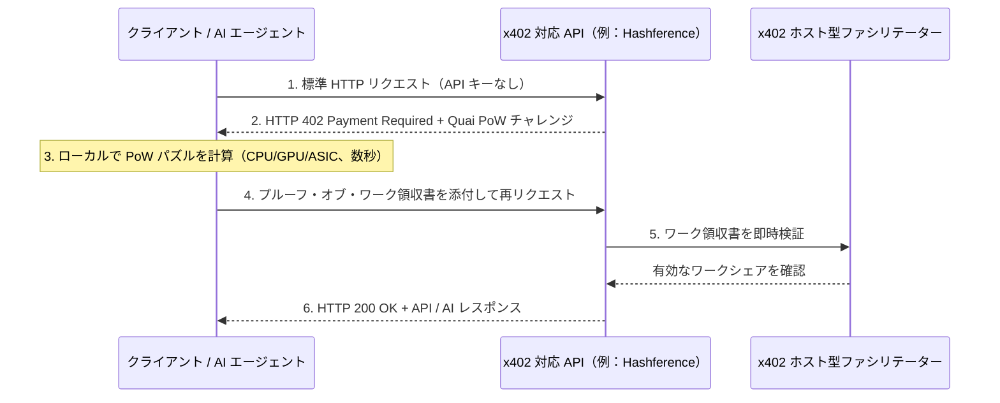

**x402 Work** と **Hashference** は、Quai ネットワークの「エネルギーベース通貨（Energy-Based Money）」の思想をウェブと AI エージェント経済へ直接もたらし、生のプルーフ・オブ・ワーク計算を HTTP リクエスト向けの即時かつパーミッションレスなマイクロペイメントへと変換します。

<CardGroup cols={3}>
  <Card title="x402 Work ドキュメント" icon="book" href="https://x402.qu.ai/docs">
    完全なプロトコル仕様、ファシリテーターの詳細、統合ガイド。
  </Card>
  <Card title="Hashference" icon="microchip" href="https://hashference.com">
    計算力、QUAI、または Qi で支払える OpenAI・Anthropic 互換 API を通じて 45 種類以上の最先端 AI モデルにアクセス。
  </Card>
  <Card title="ゼロキー体験（Zero-Key Trial）" icon="bolt" href="https://hashference.com/zero-key">
    アカウント、カード、ウォレット不要で、プルーフ・オブ・ワークを使ってライブ AI 推論を今すぐ試す。
  </Card>
</CardGroup>

## x402 Work とは？

**x402 Work** は、HTTP の `402 Payment Required` ステータスコード上に構築されたオープンな決済スキームです。人間のユーザーや自律型 AI エージェントにアカウント登録、クレジットカードの保有、ステーブルコインでのウォレット事前入金を強いる代わりに、x402 Work では任意のクライアントが数秒間の検証可能な **Quai ネットワークのプルーフ・オブ・ワーク** を実行することで、ウェブや API リクエストの料金を支払えます。

### マシン間決済にプルーフ・オブ・ワークを使う理由

- **オンボーディング摩擦ゼロ：** KYC、クレジットカード、API キー発行、事前入金済みウォレットは一切不要で、すぐに有料エンドポイントを呼び出せます。
- **AI エージェントにネイティブ対応：** AI エージェントを実行しているすべてのマシンはすでに計算資源（CPU、GPU、または ASIC）と電力を備えており、エージェントは計算力をそのまま API アクセスに変換できます。
- **プロバイダーにとっての実質的経済価値：** 解かれた各パズルは有効な Quai ネットワークのプルーフ・オブ・ワーク（SHA-256d、Scrypt、または KawPoW プロファイルに対応）であり、ホスト型ファシリテーターを通じて検証されるため、API プロバイダー側でローカルにブロックチェーンノードを立てる必要はありません。

### リクエストフローの仕組み



## クイックスタート：プルーフ・オブ・ワークで API リクエストを支払う

TypeScript/JavaScript パッケージ `x402-work-client` をインストールします。

```bash
npm install https://x402.qu.ai/x402-work-client-0.1.0.tgz
```

API キーなしで、Hashference の OpenAI 互換チャット補完 API などの x402 対応エンドポイントを呼び出します。

```typescript
import { payWithWork } from "x402-work-client";

const body = {
  model: "claude-sonnet-4-5",
  messages: [{ role: "user", content: "Explain Quai Network's PoEM consensus in two sentences." }],
};

const { response } = await payWithWork(
  "https://hashference.com/x402/v1/chat/completions",
  body,
  { maxPrice: 500_000 } // Maximum proof-of-work cost you are willing to compute
);

const data = await response.json();
console.log(data);
```

`payWithWork` が設定した `maxPrice` 上限内の HTTP `402` チャレンジを受け取ると、ローカルで自動的にプルーフ・オブ・ワークの解を計算し、ワーク領収書を添付してリクエストを再送信します。

## Hashference：Quai が支える AI 推論

**[Hashference](https://hashference.com)** は、x402 Work 上に構築されたフラッグシップサービスです。OpenAI および Anthropic 互換の統一 API を通じて **45 種類以上の最先端・オープンソース AI モデル**（Claude、GPT、DeepSeek、Llama 系列を含む）へのアクセスを提供し、柔軟な支払いモードに対応しています。

- **ゼロキー・プルーフ・オブ・ワーク（x402 Work）：** マシンの計算力を使ってリクエストごとに支払い可能。自律型エージェント、スクリプト、即時トライアルに最適です（[hashference.com/zero-key](https://hashference.com/zero-key)）。
- **QUAI および Qi 決済：** Quai ネットワークのネイティブ資産で直接 API 利用料を支払い、AI コンピュート消費を[エネルギーベース通貨](/jp/learn/tokenomics/flatcoins)と結び付けます。
- **CLI と MCP 統合：** 組み込みのコマンドラインツールと Model Context Protocol（MCP）サポートにより、AI コーディングアシスタントや自律型エージェントが推論をネイティブに発見・決済できます。

## 次のステップ

- x402 Work の完全なプロトコル仕様およびサーバー側統合ドキュメントは [x402.qu.ai/docs](https://x402.qu.ai/docs) をご覧ください。
- [hashference.com/zero-key](https://hashference.com/zero-key) でゼロキー推論をライブ体験してください。
- AI にとってエネルギーが自然な勘定単位である理由については、[フラットコインとは？](/jp/learn/tokenomics/flatcoins) をご覧ください。
