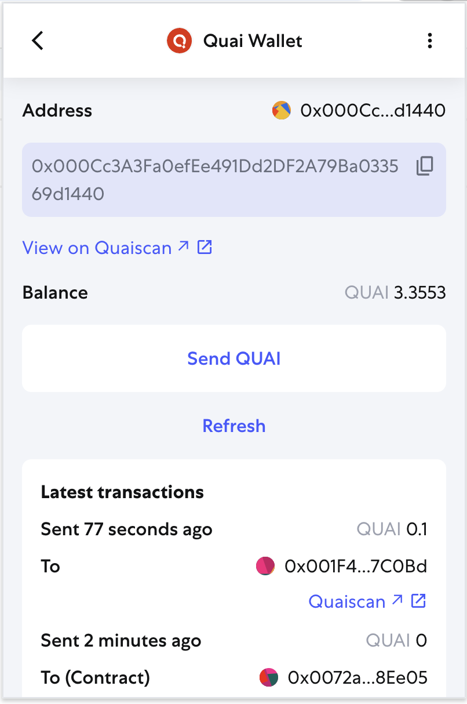

## 概要

Quai Wallet snap により、MetaMask ユーザーは Quai メインネット上で QUAI トークンを送受信できます。また、snap をインストールした MetaMask ユーザーが Quai dApps と連携できるようになります。この統合により、MetaMask ユーザーは別のウォレットを用意することなく、Quai ネットワーク・エコシステムへシームレスにアクセスできます。

## 機能

<CardGroup cols={2}>
  <Card
    title='QUAI トークンサポート'
    icon='coins'
  >
    MetaMask を通じて直接 Quai メインネット上で QUAI トークンを送受信
  </Card>
  <Card
    title='dApp 統合'
    icon='puzzle-piece'
  >
    既存の MetaMask インターフェースを使用して、対応済みの Quai dApps と連携
  </Card>
  <Card
    title='決定論的アドレス'
    icon='key'
  >
    Quai アドレスは MetaMask の鍵から生成され、再インストール後も一貫性を維持
  </Card>
  <Card
    title='シードフレーズ不要'
    icon='shield-check'
  >
    追加のシードフレーズは不要 ― Quai ウォレットは既存の MetaMask 鍵から派生
  </Card>
</CardGroup>

## インストール

### ステップ 1：MetaMask Snaps ディレクトリからインストール

1. [MetaMask Snaps ディレクトリ](https://snaps.metamask.io) にアクセスします
2. 「Quai Wallet」を検索するか、Quai Wallet snap のページへ移動します
3. 「Add to MetaMask」をクリックして snap をインストールします
4. MetaMask の案内に従ってインストールを承認します

### ステップ 2：Quai ウォレットにアクセス

インストール完了後、MetaMask から Quai ウォレットにアクセスできます。

1. MetaMask 拡張機能を開きます
2. MetaMask ウィンドウの右上にある 3 本の破線（⋮⋮⋮）をクリックします
3. ドロップダウンリストから「Snaps」をクリックします
4. リスト内の「Quai Wallet」をクリックします
5. snap が Quai ウォレットを生成するまで数秒待ちます

<Warning>
Snaps リストに「Quai Wallet」が表示されない場合は、まず Snaps ディレクトリから snap が正常にインストールされているか確認してください。
</Warning>

## ウォレット生成

Quai Wallet snap は、MetaMask の鍵から決定論的にウォレットアドレスを生成します。これは以下を意味します。

- **シードフレーズ不要：** Quai アドレスは既存の MetaMask アカウントから派生されます
- **一貫したアドレス：** MetaMask の鍵を保持している限り、常に同じ Quai アドレスが生成されます
- **高い安全性：** Quai ウォレットは MetaMask 環境のセキュリティをそのまま継承します

## 使用方法

### QUAI トークンの送信

1. MetaMask Snaps インターフェースから Quai Wallet にアクセスします
2. 「Send」または「Transfer」をクリックします
3. 受信者の Quai アドレスを入力します
4. 送信する QUAI の数量を指定します
5. トランザクションの詳細を確認します
6. MetaMask 上でトランザクションを承認します

### QUAI トークンの受信

1. MetaMask Snaps インターフェースから Quai Wallet にアクセスします
2. ウォレットインターフェースから自分の Quai アドレスをコピーします
3. このアドレスを送信者に共有して QUAI トークンを受け取ります
4. 受信したトランザクションはトランザクション履歴に表示されます

## セキュリティに関する考慮事項

- Quai ウォレットの安全性は MetaMask ウォレットと同等です
- 承認前に必ずトランザクションの詳細を確認してください
- MetaMask のシードフレーズは Ethereum と Quai の両方のウォレットを制御するため、厳重に保管してください
- フィッシング詐欺に注意し、必ず公式ソースからのみ snap をインストールしてください

<Frame>
  
</Frame>

## トラブルシューティング

### Snap が表示されない
- MetaMask Snaps ディレクトリから snap を正常にインストールしたか確認してください
- MetaMask を再読み込みするか、ブラウザを再起動してみてください
- サポートされているバージョンの MetaMask を使用しているか確認してください

### ウォレット生成の問題
- ウォレットが生成されるまで数秒待ってください
- 問題が続く場合は、snap を削除して再インストールしてみてください
- MetaMask が適切に設定され、ロック解除されているか確認してください

### トランザクションの問題
- トランザクションに十分な QUAI 残高があるか確認してください
- 受信者アドレスが有効な Quai アドレスであることを確認してください

## サポート

Quai Wallet snap に関する問題については、以下をご参照ください。
- [MetaMask Snaps ドキュメント](https://docs.metamask.io/guide/snaps.html) を確認する
- [Quai ネットワーク・コミュニティチャンネル](https://discord.gg/quai) にアクセスする
- [Quai ネットワーク・ドキュメント](/jp/learn/introduction) を確認する

## よくある質問

<AccordionGroup>
  <Accordion title="MetaMask Snap とは何ですか？">
    MetaMask Snaps は、MetaMask の機能を拡張するプログラムです。開発者が Quai ネットワークのような新しいブロックチェーンへの対応など、MetaMask ウォレットに新しい機能を追加できるようにします。
  </Accordion>
  
  <Accordion title="Quai ネットワーク用に別のウォレットが必要ですか？">
    必ずしも必要ありません。Quai Wallet snap を使えば、既存の MetaMask ウォレットを通じて直接 Quai ネットワークを利用できます。別のウォレットアプリをインストール・管理する必要はありません。ただし、dApps で最高の体験を求めるユーザーには [Pelagus Wallet](https://pelaguswallet.io) のインストールをおすすめします。
  </Accordion>
  
  <Accordion title="Quai Wallet snap は安全に使用できますか？">
    はい、Quai Wallet snap は Hacken による監査を受けており、セキュリティを重視して設計されています。既存の MetaMask 鍵から決定論的に Quai アドレスを生成するため、MetaMask 環境のセキュリティを継承します。
  </Accordion>

  <Accordion title="Quai Wallet snap で他のトークンを保管できますか？">
    現時点では対応していません。ご自身のアドレスで QRC20 トークンを受け取ることはできますが、現在は送信できません。次回のアップデートで対応予定です。
  </Accordion>

  <Accordion title="Quai Wallet snap で Quai dApps と連携できますか？">
    現時点では対応していません。Quai dApps 側で Quai Wallet snap 専用のサポートを追加する必要があり、通常の MetaMask 直接統合とはプロセスが異なります。dApps が Quai Wallet snap に対応次第、本ページを更新します。Quai dApps を利用したい場合は、[Pelagus Wallet](https://pelaguswallet.io) のインストールをおすすめします。
  </Accordion>

  <Accordion title="Quai Wallet snap 内で新しいアドレスを作成できますか？">
    いいえ、Quai Wallet snap は基本機能に絞って設計されています。Quai アドレスは MetaMask 鍵から生成され、現在 1 つの MetaMask シードフレーズにつき 1 つのアドレスのみ生成されます。複数の Quai アドレスを作成したい場合は、[Pelagus Wallet](https://pelaguswallet.io) のインストールをおすすめします。
  </Accordion>

  <Accordion title="Snaps ディレクトリで Quai Wallet snap が見つかりません。どうすればよいですか？">
    公式の MetaMask Snaps ディレクトリ（https://snaps.metamask.io）にアクセスしているか確認してください。それでも見つからない場合は、snap が一時的に利用不可になっているか、MetaMask のバージョンを更新する必要がある可能性があります。
  </Accordion>
  
  <Accordion title="Quai ウォレットの生成に数秒かかるのはなぜですか？">
    snap が暗号関数を用いて MetaMask 鍵から Quai アドレスを派生させる必要があるためです。この処理には数秒かかりますが、セッションごとに 1 回のみ実行されます。
  </Accordion>
  
  <Accordion title="同じ MetaMask アカウントで snap を再インストールするたびに同じ Quai アドレスが取得できますか？">
    はい。Quai アドレスは MetaMask 鍵から決定論的に生成されるため、同じ MetaMask アカウントを使用する限り常に同じアドレスが生成されます。
  </Accordion>
  
  <Accordion title="任意の Ethereum アドレスに QUAI トークンを送信できますか？">
    いいえ、有効な Quai アドレスにのみ QUAI トークンを送信できます。Quai アドレスは Ethereum アドレスと似ていますが、0x00 で始まります。
  </Accordion>
  
  <Accordion title="トランザクションが成功したかどうかを確認するにはどうすればよいですか？">
    MetaMask 内の Quai Wallet インターフェース、または [Quai Explorer](https://explorer.qu.ai) でトランザクションのステータスを確認できます。
  </Accordion>
  
  <Accordion title="無効なアドレスに QUAI を送信するとどうなりますか？">
    無効なアドレスに QUAI を送信した場合、トランザクションは失敗し、トークンは返却されます。送信前に必ずアドレスを再確認してください。
  </Accordion>
  
  <Accordion title="既存の Ethereum dApps で Quai Wallet snap を使用できますか？">
    Quai Wallet snap は Quai 専用に設計されています。Ethereum dApps については、引き続き通常の MetaMask ウォレットをご利用ください。
  </Accordion>
  
  <Accordion title="QUAI を送信しようとするとエラーが発生します。何が原因でしょうか？">
    よくある原因としては、QUAI 残高不足、無効な受信者アドレス、またはネットワーク接続の問題が挙げられます。残高と受信者アドレスの形式を確認してください。
  </Accordion>
  
  <Accordion title="Quai の秘密鍵をエクスポートできますか？">
    現時点では対応していません。Quai Wallet snap は現在、秘密鍵への直接アクセスを提供していません。Quai ウォレットは MetaMask の鍵から派生しているため、MetaMask アカウントにアクセスできる限り Quai ウォレットにもアクセスできます。将来のバージョンで対応予定です。
  </Accordion>
</AccordionGroup>

<Info>
Quai Wallet snap は、MetaMask ユーザーと Quai ネットワーク・エコシステムをシームレスにつなぐ架け橋として設計されています。エコシステムの成長に伴い、さらなる機能や dApp 統合が順次提供される予定です。
</Info>
