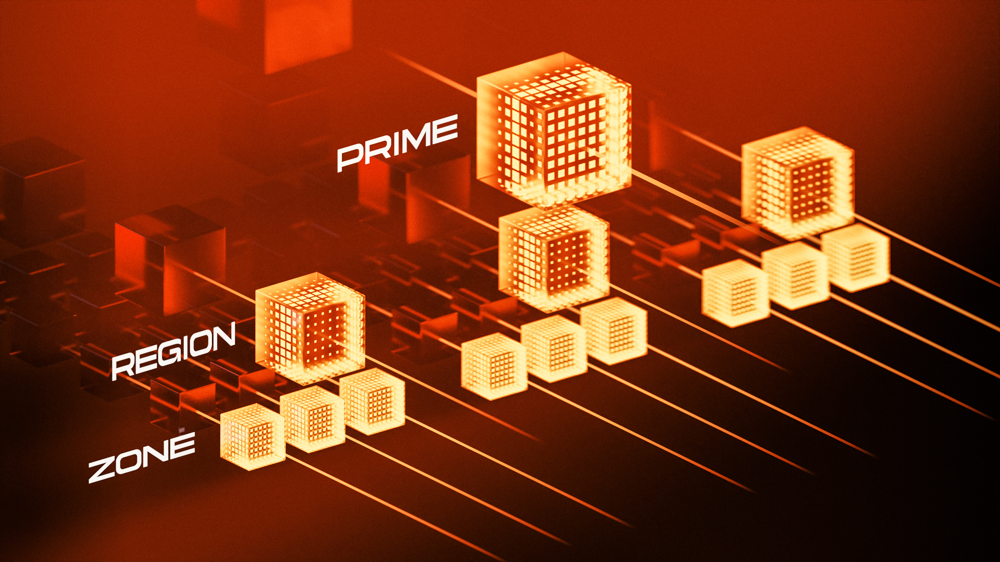

Quai ネットワークは、**プルーフ・オブ・ワークのセキュリティ**、**水平スケーラビリティ**、そして**エネルギーベース通貨（Energy-Based Money）**を統合する次世代レイヤー 1 ブロックチェーンです。

Quai は中核において、次の 4 つの画期的なイノベーションを結び付けています。

- **[エントロピー最小値証明（PoEM）](/jp/learn/advanced-introduction/poem/poem) とワークシェア：** ブロック競合を排除し、セルフィッシュマイニングを無力化し、マージマイニングされた実行階層を調整する数学的に証明された PoW コンセンサスメカニズム（ワークシェア研究は **AFT 2026** に採択）。
- **ハードマネー型価値保存資産（[QUAI](/jp/learn/tokenomics/quai-emissions) ＋ [SOAP](/jp/learn/advanced-introduction/soap)）：** EVM 互換のプログラマブルなハードマネー。[Singularity および Polaris フォーク](/jp/learn/tokenomics/protocol-upgrades) を経て**流通供給比率 約 93%**、**年間ジェネシスインフレ率 4% 未満**を達成し、さらに外部の SHA-256、Scrypt、KawPoW のマージマイニング補助金を継続的な 100% QUAI 買い戻し・焼却へと変換する **Project SOAP** によって強化されています。
- **世界初の分散型エネルギー・フラットコイン（[Qi](/jp/learn/tokenomics/flatcoins)）：** マイニングのエネルギーコストに発行量が直接連動する UTXO ベースのデジタル現金。法定通貨カストディや外部価格オラクルに頼らず、実質購買力を維持します。
- **AI・コンピュート経済向けのネイティブ決済レール（[x402 Work と Hashference](/jp/build/x402-and-hashference)）：** 人間や自律型 AI エージェントが数秒間のプルーフ・オブ・ワーク、QUAI、または Qi を使ってウェブ API や最先端 AI 推論を直接支払えるオープンな HTTP 402 決済レール。

これらのイノベーションが一体となり、グローバルな人間の商取引と自律的なマシン経済の双方に向けて設計された、分散型の通貨およびコンピュート・ネットワークを形成しています。

<CardGroup cols={2}>
  <Card
    title="解放された PoW スケーラビリティ"
    icon="arrow-up-right-dots"
    href="#解放されたスケーラビリティ"
  >
    グローバル規模でも手数料を低く抑えるよう設計されたマージマイニング階層と PoEM コンセンサス。
  </Card>
  <Card
    title="ハードマネー ＋ SOAP エンジン"
    icon="fire"
    href="/jp/learn/tokenomics/quai-emissions"
  >
    Singularity と Polaris で約 19.0 億のジェネシス QUAI を永久焼却。継続的な PoW 買い戻しに裏付けられています。
  </Card>
  <Card
    title="エネルギーベース・フラットコイン（Qi）"
    icon="bolt"
    href="/jp/learn/tokenomics/flatcoins"
  >
    減価する法定通貨ではなく、物理エネルギーコストにアンカーされた分散型デジタル現金。
  </Card>
  <Card
    title="AI・マシン決済（x402）"
    icon="microchip"
    href="/jp/build/x402-and-hashference"
  >
    ウォレットや API キーなしで、プルーフ・オブ・ワークによりウェブのリクエストや 45 種類以上の AI モデルを決済。
  </Card>
</CardGroup>

<Frame>
  
</Frame>

## 解放されたスケーラビリティ

**Quai は、マージマイニングされた階層を通じて実行能力を拡張することで、トランザクション手数料を永続的に低く保ちます。**

Quai を、交通量の増加に応じて新しい並列レーンを追加する高速道路システムと考えてみてください。[エントロピー最小値証明（PoEM）](/jp/learn/advanced-introduction/poem/poem) により、Quai は階層全体に完全なプルーフ・オブ・ワークのセキュリティを適用しながら、並列実行チェーン（[実行シャード](/jp/learn/advanced-introduction/poem/sharding/execution-sharding)）を調整します。

主な利点：
- **動的スケーリング：** 需要の拡大に応じてネットワークが処理能力を拡張
- **低手数料：** 並列実行によりモノリシックチェーン特有の手数料高騰を防止
- **トラストレスな相互運用性：** シャード間は[マイナーが検証する同時ブロック](/jp/learn/advanced-introduction/merged-mining/coincident-blocks)を通じてネイティブに接続
- **マルチアルゴリズム PoW セキュリティ：** KawPoW ブロックに SHA-256 および Scrypt ワークシェアを組み合わせることで、ASIC と GPU 全体に物理的なハードウェア・セキュリティを分散

## プルーフ・オブ・ワークが支えるハードマネー（QUAI ＋ SOAP）

従来のプルーフ・オブ・ワーク・チェーンは、「ブロック報酬がネットワークを保護する一方で継続的なマイナーの売り圧力を生む」という構造的ジレンマを抱えていました。Quai は **[Project SOAP](/jp/learn/advanced-introduction/soap)**（Subsidized Open-market Acquisition Protocol）と徹底した供給規律によって、この力学を反転させます。

- **Singularity および Polaris フォーク：** 当初の 30 億ジェネシストークンのうち**約 19.0 億 QUAI** を永久焼却し、流通供給比率を**約 93%** へ引き上げ、ジェネシス年間インフレ率を **4% 未満/年** へ削減。2029年初頭までの残りアンロックも**月間約 3.7M QUAI** まで圧縮されました。
- **継続的な SOAP 買い戻し・焼却：** Bitcoin Cash、Litecoin、Dogecoin、Ravencoin からの外部マージマイニング補助金がプロトコル管理アドレスへ流入し、公開市場で QUAI を購入して **100% 永久焼却**します。

リアルタイムの供給量、焼却量、アンロック指標はいつでも [supply.qu.ai](https://supply.qu.ai) と [soap.qu.ai](https://soap.qu.ai) で確認できます。

## エネルギーベース・フラットコイン（Qi）

**減価する法定ドルに連動したり中央集権的な銀行カストディに依存したりする従来のステーブルコインとは異なり、[Qi](/jp/learn/tokenomics/flatcoins) は物理的なエネルギーコストから安定性を導き出します。**

仕組み：
- プルーフ・オブ・ワーク・マイニングが、実世界のエネルギー価格に対するトラストレスなオンチェーン[オラクル](/jp/learn/tokenomics/token-dynamics/token-dynamics)として機能
- プロトコルが[Qi の発行量](/jp/learn/tokenomics/qi-emissions)をマイニング難易度に線形比例させて調整
- マイナーの選択と[オンチェーン変換](/jp/learn/tokenomics/token-dynamics/conversions)により、Qi の供給量と実需が動的に均衡

エネルギーは人間の経済活動と人工知能コンピュートの双方にとって普遍的な投入資源であるため、エネルギーにアンカーされた[フラットコイン](/jp/learn/tokenomics/flatcoins)は以下に適した中立的なデジタル現金となります。
- **グローバル商取引：** 法定通貨のインフレと検閲からの保護
- **AI・コンピュート経済：** 推論やマシンサービスを、それを動かす資源そのもので値付け
- **日常決済：** 現金同様の[プライバシー特性](/jp/learn/advanced-introduction/qi-privacy)を備えた固定額面 UTXO

<Note>
**これが重要な理由**

従来のブロックチェーンでは、ユーザーは以下の二者択一を迫られてきました。
- **プルーフ・オブ・ワークのセキュリティ**（ビットコイン）か、**スマートコントラクトのプログラマビリティ**（イーサリアム）か
- **分散性**か、**大規模運用時の低手数料**か
- **ハードマネーの希少性**か、**インフレ耐性のあるデジタル現金**か

Quai はこれらのトレードオフを単一のレイヤー 1 上で解消し、スケーラブルな PoW、ハードマネー QUAI、Qi エネルギー・フラットコイン、そして PoW ネイティブな AI 決済レールを統合します。
</Note>

## さあ始めましょう

<CardGroup cols={3}>
  <Card
    title="Quai を使う"
    icon="rocket"
    href="/jp/learn/use-quai"
  >
    ウォレット、取引所、Quainance DeFi、ブリッジ、各種ライブツール。
  </Card>
  <Card
    title="Quai Explorer"
    icon="magnifying-glass"
    href="https://explorer.qu.ai"
  >
    メインネットのブロック、ワークシェア、トランザクション、スマートコントラクトを確認。
  </Card>
  <Card
    title="Supply ダッシュボード"
    icon="chart-line"
    href="https://supply.qu.ai"
  >
    Polaris 後のリアルタイム供給量、ジェネシス焼却、SOAP 指標を探索。
  </Card>
  <Card
    title="フラットコインとは？"
    icon="scale-balanced"
    href="/jp/learn/tokenomics/flatcoins"
  >
    エネルギー担保フラットコインとして Qi が購買力を維持する仕組みを学ぶ。
  </Card>
  <Card
    title="x402 Work と Hashference"
    icon="microchip"
    href="/jp/build/x402-and-hashference"
  >
    AI 推論と HTTP API をプルーフ・オブ・ワークで直接支払う。
  </Card>
  <Card
    title="開発・マイニング"
    icon="code"
    href="/jp/build/introduction"
  >
    EVM コントラクトのデプロイ、Quais SDK の統合、または go-quai ノードの運用。
  </Card>
</CardGroup>
