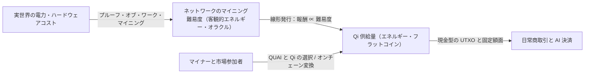

## フラットコインとは？

**フラットコイン（flatcoin）**とは、米ドルのような減価する法定通貨に対して 1:1 のペッグを維持するのではなく、時間を通じて**実質購買力を一定（フラット）に保つ**ように設計された暗号通貨です。

この用語は、法定通貨担保型ステーブルコインの次なる進化形を表すものとして、暗号資産インダストリー全体（特に Balaji Srinivasan 氏や Coinbase Ventures）で広く知られるようになりました。ステーブルコインが名目価格を `$1.00` に固定するのに対し、フラットコインは 1 単位で実際に*購入できる価値*を安定させ、保有者を法定通貨の減価やインフレから守ることを目指します。

<Note>
  **ステーブルコインとフラットコインの違いを一言で：** 米ドル建てステーブルコインは減価する政府通貨単位に連動します（`$1` で何が買えるかに関わらず `1 トークン = $1`）。一方、フラットコインは実世界の購買力に連動します（`1 トークン = 一定の実質価値`）。
</Note>

## 法定通貨ステーブルコインの限界

USDC や USDT のような法定通貨担保型ステーブルコインは暗号資産の短期的な価格変動を解決しましたが、その基盤となる法定通貨システムから次の 3 つの構造的欠陥を引き継いでいます。

1. **確実な購買力の低下：** 法定通貨は時間とともにインフレするよう設計されています。米ドルペッグ型ステーブルコインを保有するということは、発行体が準備金の国債から得る利回りを一切受け取れないまま、ドルの価値下落を 100% 引き受けることを意味します。
2. **中央集権的なカストディと検閲リスク：** 法定通貨の準備金は規制下の銀行口座や米国債に保管されています。発行体はアドレスを凍結したり、トランザクションをブラックリスト化したりでき、提携銀行の破綻リスクにもさらされます。
3. **主権通貨への依存：** 勘定単位が単一の中央銀行によって管理されている限り、法定通貨ステーブルコインはグローバルな商取引や自律型 AI エージェントのための真に中立的で国境のない通貨にはなり得ません。

## フラットコインを構築する 3 つのアプローチ

インフレ耐性のある通貨を実現するために複数の設計が提案されており、それぞれに明確なトレードオフがあります。

| 設計 | アンカーメカニズム | 主なトレードオフ |
| :--- | :--- | :--- |
| **CPI / インフレ・オラクル型フラットコイン** | 価格オラクルと担保ボールトを介して消費者物価指数（CPI）バスケットに連動 | 政府の中央集権的な統計（CPI）、外部オラクル、ガバナンス調整に依存するため、信頼の前提が再び生じる。 |
| **コモディティ / RWA 担保型フラットコイン** | トークン化された金、コモディティ、または実世界資産（RWA）バスケットで担保 | 物理的なカストディアン、法的ラッパー、オフチェーン監査が必要であり、差し押さえリスクやカウンターパーティリスクを伴う。 |
| **エネルギー担保型 PoW フラットコイン（[Qi](/jp/learn/tokenomics/qi-emissions)）** | 物理エネルギー（マイニング難易度）に比例してプルーフ・オブ・ワーク経由で直接発行 | **カストディアン不要、価格オラクル不要、法定通貨担保不要。** 熱力学と電力市場に直接アンカーされる。 |

## エネルギーが理想的な通貨アンカーである理由

金の準備高や政治的決定ではなく物理エネルギーに通貨を結び付けるという発想には、**ヘンリー・フォード**や**トーマス・エジソン**の「エネルギー・ドル」構想から**バックミンスター・フラー**の「キロワット・ドル」に至るまで、1 世紀にわたる知的系譜があります。

エネルギーはフラットコインの基準単位として独自の適性を備えています。
- **普遍性と代替性：** 1 キロワット時の電力は、東京でもオースティンでもチューリッヒでも物理的に同一です。
- **政府による恣意的操作が不可能：** どの中央銀行もジュールを増刷したり、熱力学の法則を書き換えたりすることはできません。
- **実体経済の生産活動に直結：** あらゆる物理財、製造プロセス、そして **AI コンピュート**の 1 単位は、エネルギーを主要な投入資源として必要とします。データセンターと自律型 AI エージェントが牽引する経済において、エネルギー*そのもの*が根源的な勘定単位となります。

## 分散型エネルギー・フラットコインとしての Qi の仕組み

**Qi**（中国語でエネルギーや生命力を意味する「气」に由来し、*「チー」*と発音）は、Quai ネットワークのネイティブなエネルギー担保フラットコインであり、[QUAI](/jp/learn/tokenomics/quai-emissions)（Quai の希少なハードマネー型価値保存資産）と並んで機能します。

### Qi の主な特性
- **トラストレスなエネルギー・オラクルとしてのプルーフ・オブ・ワーク：** オフチェーンの CPI フィードに依存する代わりに、Quai のプロトコルはマイニング難易度を実世界のエネルギー支出に対する直接的で改ざん不可能な代理指標として使用します。Qi のブロック報酬は難易度に**線形に**連動するため、各 Qi は時間を通じて一貫した物理エネルギーの単位を表します。
- **プレマインなし・ジェネシス供給ゼロ：** Qi は**初期供給量 0** でローンチされました。流通するすべての Qi は、プルーフ・オブ・ワーク・マイニングまたはプロトコルレベルの [QUAI ↔ Qi 変換](/jp/learn/tokenomics/token-dynamics/conversions) のみを通じて発行されます。
- **需要応答型の供給：** 需要変動によって価格が大きく振れる固定上限の価値保存資産とは異なり、Qi の供給量はマイナーの報酬選択とオンチェーン変換を通じて、需要が高まると拡大し、需要が落ちると縮小します。これにより、需要ショックを価格ではなく供給量で吸収します。
- **設計段階から備わった現金同様のプライバシー：** 固定額面と再利用不可アドレスを備えた UTXO 台帳上に構築されており（[Qi プライバシー](/jp/learn/advanced-introduction/qi-privacy)）、中央集権的な凍結スイッチのない物理的なデジタル現金のように機能します。

## 通貨モデルの比較

| 特性 | 法定通貨ステーブルコイン（USDC/USDT） | アルゴリズム型ステーブルコイン | CPI オラクル型フラットコイン | **Qi（Quai エネルギー・フラットコイン）** |
| :--- | :--- | :--- | :--- | :--- |
| **価値のアンカー** | 米ドル（法定通貨） | 自己参照型トークンペッグ | 政府の CPI バスケット | **実世界のエネルギー（PoW 難易度）** |
| **インフレ耐性** | なし（米ドルの減価に連動） | 不安定 / デペッグリスクあり | CPI の精度に依存 | **物理エネルギーコストにアンカー** |
| **担保 / カストディアン** | 中央集権的銀行および米国債 | 内生的 / 脆弱 | 過剰担保ボールト | **不要（ネイティブ PoW 発行）** |
| **オラクル依存** | オフチェーン銀行証明 | 市場価格オラクル | CPI ＋ 価格オラクル | **不要（難易度はオンチェーンネイティブ）** |
| **検閲耐性** | 低（発行体の凍結鍵あり） | 中 | 中 | **高（分散型 PoW ＋ UTXO プライバシー）** |
| **AI・コンピュート対応** | KYC や銀行レールが必要 | 脆弱 | 複雑な DeFi ラッパーが必要 | **PoW および [x402 Work](/jp/build/x402-and-hashference) にネイティブ対応** |

## 二重トークンの相乗効果：フラットコイン ＋ ハードマネー

フラットコイン単体は購買力を維持するために設計されており、ネットワーク成長を価値上昇型の準備資産として取り込むものではありません。そのため、Quai は **Qi** を **[QUAI](/jp/learn/tokenomics/quai-emissions)** と組み合わせています。

- **QUAI** は長期的なネットワーク成長と希少性を捕捉します（[Polaris](/jp/learn/tokenomics/protocol-upgrades) 以降、流通比率約 93%、ジェネシス年間インフレ率 4% 未満、[SOAP](/jp/learn/advanced-introduction/soap) による継続的な焼却）。
- **Qi** は安定した価格表示、日常のデジタル現金、マシン間コンピュート決済のためのエネルギー連動フラットコインを提供します。
- **オンチェーン変換** により、中央集権型ブリッジやカストディアル発行体を介さず、両資産がプロトコルレベルで直接接続されます。

## さらに詳しく学ぶ

<CardGroup cols={2}>
  <Card title="Qi の排出量" icon="bolt" href="/jp/learn/tokenomics/qi-emissions">
    Qi の難易度比例による線形発行式と供給メカニズムを詳しく見る。
  </Card>
  <Card title="トークンダイナミクスと変換" icon="arrows-rotate" href="/jp/learn/tokenomics/token-dynamics/conversions">
    マイナーやユーザーがオンチェーンで QUAI と Qi を変換する仕組みを学ぶ。
  </Card>
  <Card title="ライブ変換ダッシュボード" icon="chart-line" href="https://conversions.quai.network/">
    リアルタイムの QUAI ↔ Qi 変換レートを確認する。
  </Card>
  <Card title="ライブ供給ダッシュボード" icon="gauge-high" href="https://supply.qu.ai">
    supply.qu.ai で QUAI と Qi の供給指標をリアルタイム追跡する。
  </Card>
</CardGroup>
