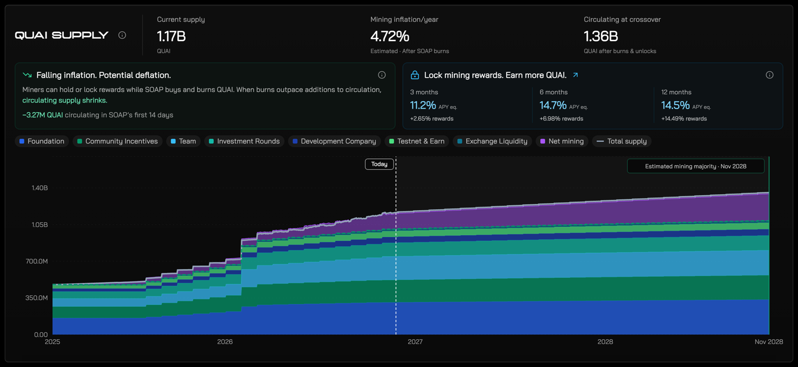
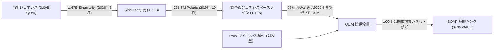
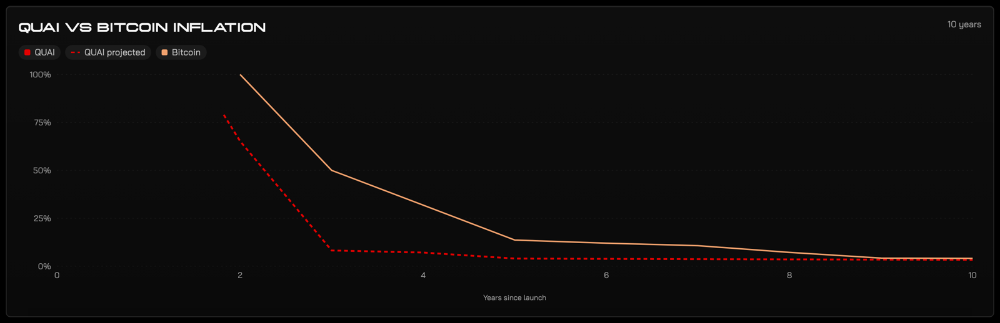
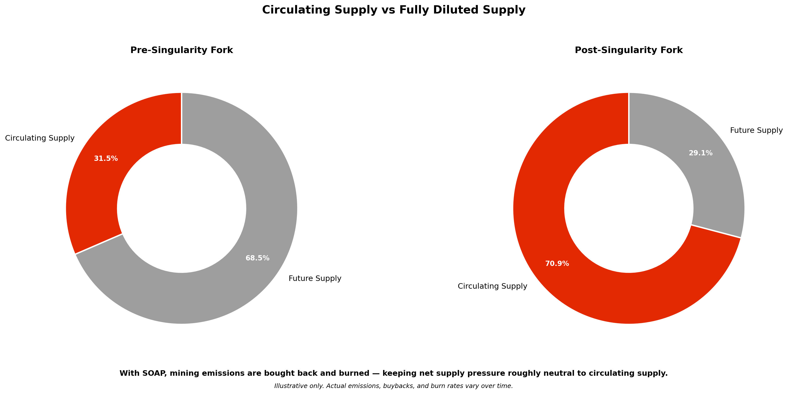

## 排出量の概要

QUAI の供給量は、次の単一かつ透明な方程式に従って推移します。

$$
\text{Total Supply} = \text{Genesis Unlocks} + \text{Mining Emissions} - \text{SOAP Burns}
$$

3 つの主要なプロトコル・マイルストーンが QUAI のハードマネー供給軌道を定義しています。

- **[Singularity フォーク](/jp/learn/tokenomics/protocol-upgrades)（2026年3月、`go-quai v0.51.0`）：** 投資家、Dominant Strategies、Quai Foundation の多者合意により **1,667,159,984 QUAI**（将来ジェネシスアンロックの 81.1%）を永久焼却し、既定ジェネシスベースラインを **3,000,000,000 QUAI** から **1,332,840,016 QUAI** へ引き下げました。
- **[Polaris フォーク](/jp/learn/tokenomics/protocol-upgrades)（2026年10月、`go-quai v0.57.0`）：** Quai 創設者と Dominant Strategies チームが、残りの将来ジェネシス配分から追加で **236,456,538 QUAI** を永久焼却。累計ジェネシス焼却量は **1,903,616,522 QUAI（約 19.0 億）** に達し、調整後ジェネシスベースラインは **1,096,383,478 QUAI** となりました。
- **[Project SOAP](/jp/learn/advanced-introduction/soap)（2025年12月～継続中）：** 外部マージマイニングのプルーフ・オブ・ワーク補助金（BCH、LTC、DOGE、RVN）の 100% を継続的な公開市場での QUAI 買い戻しに充て、**100% 永久焼却**します。これまでに **254.6M QUAI 以上** が焼却されています。

<Frame caption="supply.qu.ai による Polaris 後のライブ QUAI 供給ステータスと主要カタリスト（2026年11月）">
	
</Frame>

<CardGroup cols={3}>
  <Card title="ライブ Supply ダッシュボード" icon="chart-line" href="https://supply.qu.ai">
    supply.qu.ai でリアルタイムの流通供給量、ジェネシス焼却、マイニング排出、アンロックスケジュールを追跡。
  </Card>
  <Card title="SOAP 焼却ダッシュボード" icon="fire" href="https://soap.qu.ai">
    マージマイニング補助金の流入と累計 QUAI 買い戻し・焼却をライブ監視。
  </Card>
  <Card title="Explorer 上の焼却アドレス" icon="magnifying-glass" href="https://explorer.qu.ai/address/0x0050AF0000000000000000000000000000000000">
    explorer.qu.ai で永久焼却された QUAI をオンチェーン確認。
  </Card>
</CardGroup>

## Polaris 後の供給スナップショット

Polaris フォーク（2026年10月13日有効化、10月30日の基準日以降にアンロックスケジュール発効）により、長期的なインサイダー未ベスティング残高が大幅に削減され、QUAI の成熟した供給制約型ハードマネー資産への移行が加速しました。

| 指標 | Polaris 前（Singularity 後） | Polaris 後（現在） |
| :--- | :--- | :--- |
| **当初ジェネシス配分** | 3,000,000,000 QUAI | 3,000,000,000 QUAI |
| **累計ジェネシス焼却量** | 1,667,159,984 QUAI | **1,903,616,522 QUAI（約 1.90B）** |
| **調整後ジェネシスベースライン** | 1,332,840,016 QUAI | **1,096,383,478 QUAI** |
| **流通供給比率** | 約 77% | **約 92.8%（1.17B QUAI）** |
| **年間ジェネシスインフレ率** | 約 13% / 年 | **4% 未満 / 年** |
| **純マイニングインフレ率（SOAP 焼却後）** | — | **約 4.72% / 年** *（推定）* |
| **ネットワーク総インフレ率（SOAP 含む）** | 約 18% / 年 | **9% 未満 / 年** |
| **月次ジェネシスアンロック** | 約 13M QUAI / 月 | **約 3.7M QUAI / 月** *（流通量の約 0.32%、2027年5月より 3.6M）* |
| **残りロック済みジェネシス残高** | 約 327M QUAI | **約 90.4M QUAI（7.2%）** *（2029年初頭にベスティング完了）* |
| **累計 SOAP 焼却量** | — | **254.6M+ QUAI** |

<Frame caption="2028年11月のマイニング過半数到達までの Polaris 後 QUAI 供給推移（supply.qu.ai）">
	
</Frame>

<Note>
  リアルタイムの流通供給量、累計 SOAP 焼却量、日次排出内訳については、常に [supply.qu.ai](https://supply.qu.ai) をご参照ください。フォークごとの詳細な内訳は [プロトコルアップグレード](/jp/learn/tokenomics/protocol-upgrades) をご覧ください。
</Note>

**ハードマネーへの軌道：** 残りのジェネシスアンロックが縮小し（2029年初頭の完全ベスティングに向けて月間約 3.7M QUAI）、SOAP の買い戻しがマイニング排出を相殺していくにつれ、純供給増加率はゼロに近づきます。そして SOAP 焼却量が新規マイニング QUAI を上回るたびに、純デフレへと転じます。

## トークン排出量の再考

従来の暗号通貨は固定の時間ベース排出スケジュールを採用しており、ビットコインの 2,100 万枚上限がその代表例です。予測可能である一方、硬直的なスケジュールは需要やハッシュパワーの変化に対応できず、好況・不況サイクルを増幅させる可能性があります。

価値保存トークンにおいて持続的な価値創出を実現するには、供給の伸びがネットワーク採用の伸びを下回り続ける必要があります。Quai は恣意的なカレンダー上のクリフのみに頼るのではなく、以下の要素を組み合わせています。

- **対数型のマイニング排出：** QUAI のブロック報酬はネットワーク難易度の成長に反比例してスケーリングし、ハッシュレートと採用の拡大に伴って発行量が自然に減速します。
- **二重トークンの柔軟性：** マイナーは [QUAI](/jp/learn/tokenomics/quai-emissions)（希少な価値保存資産）または [Qi](/jp/learn/tokenomics/qi-emissions)（エネルギー担保[フラットコイン](/jp/learn/tokenomics/flatcoins)）のいずれを受け取るか選択でき、希少性と決済流動性のバランスを動的に保ちます。
- **SOAP 公開市場焼却：** 外部のプルーフ・オブ・ワーク補助金が流通している QUAI を継続的に購入・焼却し、需要に連動した永続的な供給吸収源を生み出します。

## ネットワーク価値理論と排出設計

ネットワークシステムは通常、次の 2 つの成長フェーズを経ます。
- **初期段階：** ネットワーク効果による急速な $n^2$ 拡大
- **成熟段階：** 効率向上による着実な $n \log(n)$ 拡大

Quai の適応型マイニング発行は、ハッシュレート、難易度、実利用という現実世界のネットワーク状況に連動し、3 つの利点をもたらします。
- **適応的供給：** プロトコルの発行量がマイニング難易度と需要に直接応答します。
- **効率的な配分：** 資本とセキュリティ報酬が最も生産性の高い場所へ流れます。
- **供給ショックの軽減：** 市場を不安定化させるリリースクリフのない、制御された透明な排出曲線を実現します。

## QUAI 排出分配とビットコインとのインフレ比較

QUAI は公平でマイニング主導のハードアセットへ収束するよう設計されています。Singularity および Polaris フォークを通じて**約 19.0 億**のジェネシストークンが永久焼却され、すでに供給の**約 92.8%** が流通している現在、累計プルーフ・オブ・ワーク・マイニング報酬は **2028年11月** までにアンロック済みジェネシス配分を上回る見込み（クロスオーバー時流通量 約 1.36B QUAI）であり、2030年末時点では総発行量の **約 62.6%**（SOAP 焼却前）に達すると予測されています。

<Frame caption="10 年間のインフレ推移比較：QUAI（Polaris + SOAP 後）vs. ビットコイン（supply.qu.ai）">
	
</Frame>

流通供給量、ジェネシスアンロック、ロックマイニング APY、SOAP 焼却の最新チャートは [supply.qu.ai](https://supply.qu.ai) をご覧ください。

## SOAP 買い戻しと焼却

[Project SOAP](/jp/learn/advanced-introduction/soap) の稼働により、外部のプルーフ・オブ・ワーク親チェーン（BCH、LTC、DOGE、RVN）からのマージマイニング補助金は AuxPoW コミットメントを通じてプロトコルレベルでプロトコル管理アドレスにルーティングされ、公開市場で QUAI に変換された上で **100% 永久焼却**されます。

実運用では以下の流れで機能します。
- 外部チェーンの補助金が AuxPoW ワークシェアのコミットメントを通じてプロトコルレベルで捕捉されます。
- その補助金を用いて公開市場で継続的に QUAI を購入します。
- 購入された QUAI の **100%** が焼却アドレス（[`0x0050AF0000000000000000000000000000000000`](https://explorer.qu.ai/address/0x0050AF0000000000000000000000000000000000)）へ送られ、流通供給量を永久に削減します。

完全な技術設計（ワークシェア、AuxPoW 検証、委員会ガバナンス、報酬フロー）については [Project SOAP](/jp/learn/advanced-introduction/soap) をご覧ください。リアルタイムの焼却指標は [soap.qu.ai](https://soap.qu.ai) および [supply.qu.ai](https://supply.qu.ai) で確認できます。

<Frame>
	
</Frame>

<AccordionGroup>
<Accordion title="過去のジェネシスベースライン（Singularity / Polaris 前）">

**Singularity フォーク**（2026年3月）および **Polaris フォーク**（2026年10月）以前、Quai は初期の既定ジェネシスベースライン **3,000,000,000 QUAI** でローンチされました。合計 **1,903,616,522 QUAI** に及ぶ 2 回のプロトコルレベル焼却を経て、このベースラインは **1,096,383,478 QUAI** へ永久に引き下げられました。

<Frame>
	
</Frame>

<Note>
  上記のチャートは当初の **Singularity フォーク**による削減（3.00B → 1.33B）を反映したものです。その後の **Polaris フォーク**で創設者および Dominant Strategies の残りアンロック分からさらに **236,456,538 QUAI** が焼却され、調整後ジェネシスベースラインは **1,096,383,478 QUAI** となりました。Polaris 後の最新チャートは [supply.qu.ai](https://supply.qu.ai) をご覧ください。
</Note>

### 当初ローンチ時のアンロックスケジュール（Singularity・Polaris により更新済み）
| カテゴリー | 当初スケジュール |
| :--- | :--- |
| **チーム（16%）** | 1 年クリフ、36 ヶ月間の月次アンロック（1〜4 年目）*（残りの創設者・チーム分アンロックは Polaris で焼却）* |
| **投資ラウンド（14%）** | シード 1（10%）：TGE で 25%、1 年クリフ、36 ヶ月線形 · シード 2（2%）：1 年クリフ、クリフ時 25%、36 ヶ月線形 · 戦略的（2%）：TGE で 25%、1 年クリフ、36 ヶ月線形 |
| **開発会社（6%）** | TGE で 25%、6 ヶ月クリフ、42 ヶ月間の月次アンロック *（残りのアンロックは Singularity および Polaris で焼却）* |
| **財団準備金（33%）** | TGE で 2%、6 ヶ月クリフ、66 ヶ月間の月次アンロック *（大半を Singularity で焼却）* |
| **コミュニティインセンティブ（23%）** | TGE で 15%、6 ヶ月クリフ、42 ヶ月間の月次アンロック |
| **テストネット＆アーンプログラム（5%）** | Earn Wave 1 およびテストネット報酬：TGE で 100% · Wave 2・3：初期 25%、24 ヶ月線形 |
| **取引所 / マーケットメイキング（2%）** | TGE で 100% 利用可能 |

</Accordion>

<Accordion title="排出メカニズムの詳細">

QUAI の供給量は、ジェネシスアンロック、プルーフ・オブ・ワーク・マイニング排出、および SOAP 買い戻し・焼却フローによって決定されます。

さらなる技術メカニズムの詳細：
- [プロトコルアップグレード（Singularity および Polaris）](/jp/learn/tokenomics/protocol-upgrades)
- [ブロック報酬](/jp/learn/tokenomics/token-dynamics/block-rewards)
- [変換（QUAI ↔ Qi）](/jp/learn/tokenomics/token-dynamics/conversions)
- [難易度調整](/jp/learn/tokenomics/token-dynamics/difficulty-adjustments)

</Accordion>
</AccordionGroup>
