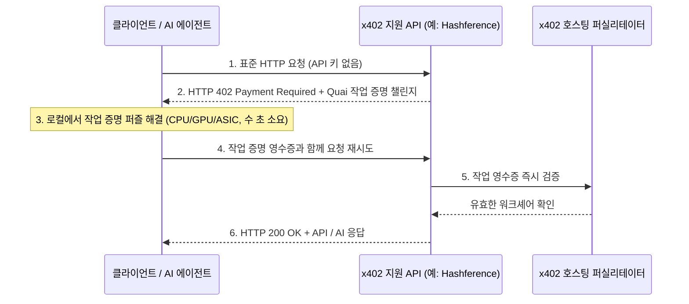

**x402 Work**와 **Hashference**는 Quai 네트워크의 에너지 기반 화폐(Energy-Based Money) 철학을 웹과 AI 에이전트 경제로 직접 가져와, 순수 작업 증명 연산을 HTTP 요청을 위한 즉각적이고 비허가형인 소액 결제로 전환합니다.

<CardGroup cols={3}>
  <Card title="x402 Work 문서" icon="book" href="https://x402.qu.ai/docs">
    전체 프로토콜 명세, 퍼실리테이터 세부 정보 및 통합 가이드.
  </Card>
  <Card title="Hashference" icon="microchip" href="https://hashference.com">
    컴퓨팅, QUAI 또는 Qi로 결제하며 OpenAI 및 Anthropic 호환 API를 통해 45개 이상의 최첨단 AI 모델에 액세스하세요.
  </Card>
  <Card title="제로 키(Zero-Key) 체험" icon="bolt" href="https://hashference.com/zero-key">
    계정, 카드 또는 지갑 없이 작업 증명만으로 실시간 AI 추론을 즉시 테스트해 보세요.
  </Card>
</CardGroup>

## x402 Work란 무엇인가?

**x402 Work**는 HTTP `402 Payment Required` 상태 코드를 기반으로 구축된 개방형 결제 방식입니다. 사람이나 자율 AI 에이전트에게 계정을 등록하거나 신용카드를 등록하거나 스테이블코인으로 암호화폐 지갑을 미리 충전하도록 강요하는 대신, x402 Work는 모든 클라이언트가 몇 초간의 검증 가능한 **Quai 네트워크 작업 증명**을 수행하여 웹 또는 API 요청 비용을 결제할 수 있게 합니다.

### 왜 머신 투 머신(M2M) 결제에 작업 증명을 사용하는가?

- **온보딩 마찰 제로:** 유료 엔드포인트 호출을 시작하기 위해 KYC, 신용카드, API 키 발급 또는 사전 충전된 지갑이 전혀 필요하지 않습니다.
- **AI 에이전트 네이티브:** AI 에이전트를 실행하는 모든 머신은 이미 컴퓨팅 자원(CPU, GPU 또는 ASIC)과 전력을 보유하고 있으므로, 에이전트가 컴퓨팅을 API 액세스로 직접 전환할 수 있습니다.
- **제공자를 위한 실질적 경제 가치:** 해결된 각 퍼즐은 호스팅된 퍼실리테이터를 통해 검증되는 유효한 Quai 네트워크 작업 증명(SHA-256d, Scrypt 또는 KawPoW 프로필 지원)이므로, API 제공자는 로컬 블록체인 노드를 직접 구축할 필요가 없습니다.

### 요청 흐름 작동 방식



## 빠른 시작: 작업 증명으로 API 요청 결제하기

`x402-work-client` TypeScript/JavaScript 패키지를 설치합니다.

```bash
npm install https://x402.qu.ai/x402-work-client-0.1.0.tgz
```

API 키 없이 Hashference의 OpenAI 호환 채팅 완성(chat completions) API와 같은 x402 지원 엔드포인트를 호출합니다.

```typescript
import { payWithWork } from "x402-work-client";

const body = {
  model: "claude-sonnet-4-5",
  messages: [{ role: "user", content: "Explain Quai Network's PoEM consensus in two sentences." }],
};

const { response } = await payWithWork(
  "https://hashference.com/x402/v1/chat/completions",
  body,
  { maxPrice: 500_000 } // 연산할 최대 작업 증명 비용 한도
);

const data = await response.json();
console.log(data);
```

`payWithWork`가 설정된 `maxPrice` 한도 내의 HTTP `402` 챌린지를 수신하면, 로컬에서 자동으로 작업 증명 해답을 계산하고 작업 영수증을 첨부하여 요청을 재시도합니다.

## Hashference: Quai 기반 AI 추론 플랫폼

**[Hashference](https://hashference.com)**는 x402 Work 위에 구축된 대표 서비스입니다. 유연한 결제 방식과 함께 **45개 이상의 최첨단 및 오픈소스 AI 모델**(Claude, GPT, DeepSeek, Llama 계열 포함)에 대한 통합 OpenAI 및 Anthropic 호환 API 액세스를 제공합니다.

- **제로 키 작업 증명 (x402 Work):** 머신의 컴퓨팅 자원으로 요청당 결제—자율 에이전트, 스크립트 및 즉각적인 테스트에 이상적입니다([hashference.com/zero-key](https://hashference.com/zero-key)).
- **QUAI 및 Qi 결제:** 네이티브 Quai 네트워크 자산으로 API 사용료를 직접 충전하여 AI 컴퓨팅 소비를 [에너지 기반 화폐](/ko/learn/tokenomics/flatcoins)와 연결합니다.
- **CLI 및 MCP 통합:** 내장 명령줄 도구와 모델 컨텍스트 프로토콜(MCP) 지원을 통해 AI 코딩 어시스턴트와 자율 에이전트가 추론을 네이티브하게 탐색하고 결제할 수 있습니다.

## 다음 단계

- [x402.qu.ai/docs](https://x402.qu.ai/docs)에서 전체 x402 Work 프로토콜 및 서버 측 통합 문서를 확인하세요.
- [hashference.com/zero-key](https://hashference.com/zero-key)에서 제로 키 추론을 직접 체험해 보세요.
- [플랫코인이란 무엇인가?](/ko/learn/tokenomics/flatcoins)에서 에너지가 AI의 자연스러운 계산 단위인 이유를 알아보세요.
