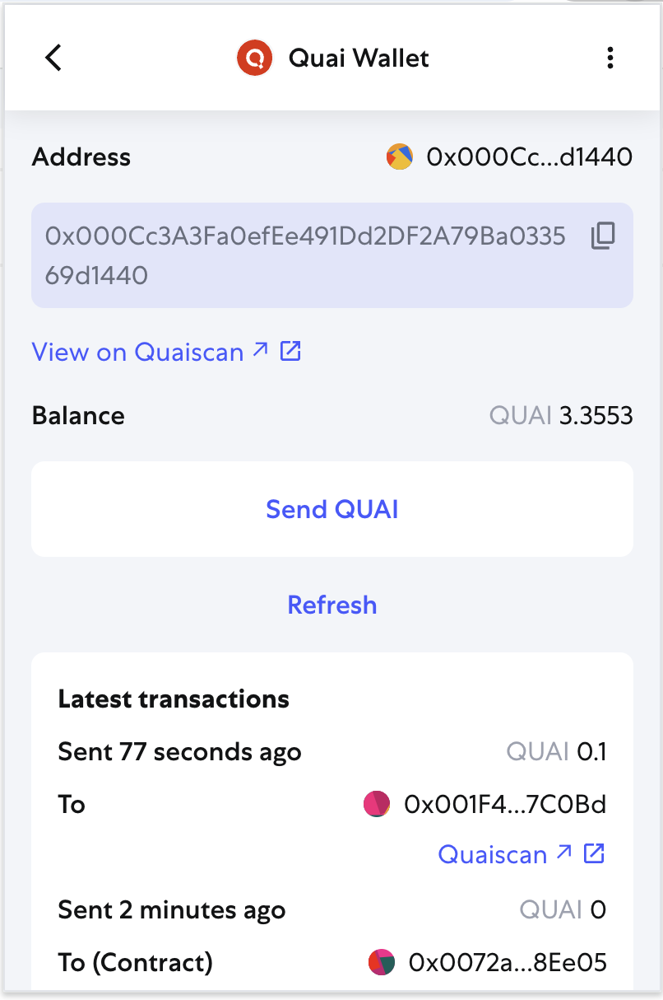

## 개요

Quai Wallet Snap을 사용하면 MetaMask 사용자가 Quai 메인넷에서 QUAI 토큰을 전송하고 수신할 수 있습니다. 또한 Snap이 설치된 MetaMask 사용자와 Quai dApp이 상호작용할 수 있도록 지원합니다. 이 통합은 MetaMask 사용자가 별도의 지갑을 설치하지 않고도 Quai 네트워크 생태계에 원활하게 접근할 수 있는 방법을 제공합니다.

## 주요 기능

<CardGroup cols={2}>
  <Card
    title='QUAI 토큰 지원'
    icon='coins'
  >
    MetaMask를 통해 Quai 메인넷에서 직접 QUAI 토큰을 전송 및 수신하세요
  </Card>
  <Card
    title='dApp 통합'
    icon='puzzle-piece'
  >
    지원이 추가되는 대로 기존 MetaMask 인터페이스를 사용해 Quai dApp과 상호작용하세요
  </Card>
  <Card
    title='결정적 주소'
    icon='key'
  >
    Quai 주소가 MetaMask 키에서 생성되어 재설치 시에도 일관성을 유지합니다
  </Card>
  <Card
    title='별도 시드 구문 불필요'
    icon='shield-check'
  >
    추가 시드 구문이 필요 없습니다—Quai 지갑은 기존 MetaMask 키에서 파생됩니다
  </Card>
</CardGroup>

## 설치 방법

### 1단계: MetaMask Snaps 디렉터리에서 설치

1. [MetaMask Snaps 디렉터리](https://snaps.metamask.io)를 방문합니다
2. "Quai Wallet"을 검색하거나 Quai Wallet Snap 페이지로 이동합니다
3. "Add to MetaMask"를 클릭하여 Snap을 설치합니다
4. MetaMask 안내에 따라 설치를 승인합니다

### 2단계: Quai 지갑 액세스

설치가 완료되면 MetaMask를 통해 Quai 지갑에 액세스할 수 있습니다:

1. MetaMask 확장 프로그램을 엽니다
2. MetaMask 창 우측 상단의 점선 메뉴 아이콘(⋮⋮⋮)을 클릭합니다
3. 드롭다운 목록에서 "Snaps"를 클릭합니다
4. 목록에서 "Quai Wallet"을 클릭합니다
5. Snap이 Quai 지갑을 생성할 때까지 기다립니다(몇 초 정도 소요됩니다)

<Warning>
Snaps 목록에 "Quai Wallet"이 보이지 않는다면, 먼저 Snaps 디렉터리에서 Snap을 정상적으로 설치했는지 확인하세요.
</Warning>

## 지갑 생성

Quai Wallet Snap은 MetaMask 키에서 결정적으로(deterministically) 지갑 주소를 생성합니다. 이는 다음을 의미합니다:

- **시드 구문 불필요**: Quai 주소는 기존 MetaMask 계정에서 파생됩니다
- **일관된 주소**: MetaMask 키를 보유하고 있는 한 항상 동일한 Quai 주소가 생성됩니다
- **안전함**: Quai 지갑은 기존 MetaMask 설정의 보안을 그대로 계승합니다

## 사용 방법

### QUAI 토큰 전송

1. MetaMask Snaps 인터페이스를 통해 Quai Wallet에 액세스합니다
2. "Send" 또는 "Transfer"를 클릭합니다
3. 수신자의 Quai 주소를 입력합니다
4. 전송할 QUAI 수량을 지정합니다
5. 거래 세부 정보를 검토합니다
6. MetaMask를 통해 거래를 확인합니다

### QUAI 토큰 수신

1. MetaMask Snaps 인터페이스를 통해 Quai Wallet에 액세스합니다
2. 지갑 인터페이스에서 본인의 Quai 주소를 복사합니다
3. 이 주소를 상대방과 공유하여 QUAI 토큰을 수신합니다
4. 수신된 거래는 거래 내역에 표시됩니다

## 보안 고려 사항

- Quai 지갑의 보안 수준은 MetaMask 지갑과 동일합니다
- 확인하기 전에 항상 거래 세부 정보를 검증하세요
- MetaMask 시드 구문을 안전하게 보관하세요—이 시드 구문은 이더리움 지갑과 Quai 지갑을 모두 제어합니다
- 피싱 시도에 주의하고 공식 출처에서만 Snap을 설치하세요

<Frame>
  
</Frame>

## 문제 해결

### Snap이 표시되지 않는 경우
- MetaMask Snaps 디렉터리에서 Snap이 성공적으로 설치되었는지 확인하세요
- MetaMask를 새로 고침하거나 브라우저를 재시작해 보세요
- 지원되는 버전의 MetaMask를 사용 중인지 확인하세요

### 지갑 생성 문제
- 지갑이 생성될 때까지 몇 초간 기다려 주세요
- 문제가 지속되면 Snap을 제거한 후 다시 설치해 보세요
- MetaMask가 올바르게 설정되고 잠금 해제되어 있는지 확인하세요

### 거래 문제
- 거래를 수행할 충분한 QUAI 잔액이 있는지 확인하세요
- 수신자 주소가 유효한 Quai 주소인지 확인하세요

## 지원

Quai Wallet Snap 관련 문제가 발생한 경우:
- [MetaMask Snaps 문서](https://docs.metamask.io/guide/snaps.html)를 확인하세요
- [Quai 네트워크 커뮤니티 채널](https://discord.gg/quai)을 방문하세요
- [Quai 네트워크 문서](/ko/learn/introduction)를 살펴보세요

## 자주 묻는 질문 (FAQ)

<AccordionGroup>
  <Accordion title="MetaMask Snap이란 무엇인가요?">
    MetaMask Snaps는 MetaMask의 기능을 확장하는 프로그램입니다. 개발자는 이를 통해 Quai 네트워크와 같은 새로운 블록체인 지원 등 새로운 기능을 MetaMask 지갑에 추가할 수 있습니다.
  </Accordion>

  <Accordion title="Quai 네트워크용 별도 지갑이 필요한가요?">
    반드시 그렇지는 않습니다. Quai Wallet Snap을 사용하면 별도의 지갑 애플리케이션을 설치하거나 관리하지 않고도 기존 MetaMask 지갑을 통해 Quai 네트워크와 직접 상호작용할 수 있습니다. 다만 dApp에서 최상의 경험을 원하시는 사용자께는 [Pelagus Wallet](https://pelaguswallet.io) 설치를 권장합니다.
  </Accordion>

  <Accordion title="Quai Wallet Snap은 안전하게 사용할 수 있나요?">
    네, Quai Wallet Snap은 Hacken의 보안 감사를 받았으며 보안을 최우선으로 설계되었습니다. 기존 MetaMask 키에서 결정적으로 Quai 주소를 생성하므로 MetaMask 설정의 보안을 그대로 계승합니다.
  </Accordion>

  <Accordion title="Quai Wallet Snap에 다른 토큰도 보관할 수 있나요?">
    아직은 불가능합니다. 본인 주소로 QRC20 토큰을 수신할 수는 있지만 현재 전송은 지원되지 않습니다. 이는 다음 업데이트에서 지원될 예정입니다.
  </Accordion>

  <Accordion title="Quai Wallet Snap으로 Quai dApp과 상호작용할 수 있나요?">
    아직은 불가능합니다. Quai dApp은 MetaMask 직접 통합과 다른 방식으로 Quai Wallet Snap 지원을 별도로 추가해야 합니다. dApp 지원이 추가되면 이 페이지에 업데이트될 예정입니다. Quai dApp과 상호작용하고 싶으시다면 [Pelagus Wallet](https://pelaguswallet.io) 설치를 권장합니다.
  </Accordion>

  <Accordion title="Quai Wallet Snap 내에서 새 주소를 생성할 수 있나요?">
    아니요, Quai Wallet Snap은 기본 기능에 초점을 맞춰 설계되었습니다. Quai 주소는 MetaMask 키에서 생성되며 현재 각 MetaMask 시드 구문당 하나의 주소만 생성됩니다. 여러 개의 Quai 주소를 생성하려면 [Pelagus Wallet](https://pelaguswallet.io) 설치를 권장합니다.
  </Accordion>

  <Accordion title="Snaps 디렉터리에서 Quai Wallet Snap을 찾을 수 없습니다. 어떻게 해야 하나요?">
    공식 MetaMask Snaps 디렉터리(https://snaps.metamask.io)에 방문했는지 확인하세요. 여전히 찾을 수 없다면 Snap이 일시적으로 비활성화되었거나 MetaMask 버전을 업데이트해야 할 수 있습니다.
  </Accordion>

  <Accordion title="Quai 지갑을 생성하는 데 몇 초가 걸리는 이유는 무엇인가요?">
    Snap이 암호화 함수를 사용하여 MetaMask 키로부터 Quai 주소를 파생해야 하기 때문입니다. 이 과정은 몇 초 정도 소요되지만 세션당 한 번만 실행됩니다.
  </Accordion>

  <Accordion title="동일한 MetaMask 계정으로 Snap을 다시 설치해도 항상 같은 Quai 주소를 받게 되나요?">
    네! Quai 주소는 MetaMask 키에서 결정적으로 생성되므로, 동일한 MetaMask 계정을 사용하는 한 항상 같은 주소를 받게 됩니다.
  </Accordion>

  <Accordion title="아무 이더리움 주소로 QUAI 토큰을 전송할 수 있나요?">
    아니요, 유효한 Quai 주소로만 QUAI 토큰을 전송할 수 있습니다. Quai 주소는 이더리움 주소와 유사하게 보이지만 `0x00`으로 시작합니다.
  </Accordion>

  <Accordion title="거래가 성공했는지 어떻게 확인할 수 있나요?">
    MetaMask 내 Quai Wallet 인터페이스 또는 [Quai Explorer](https://explorer.qu.ai)에서 거래 상태를 확인할 수 있습니다.
  </Accordion>

  <Accordion title="유효하지 않은 주소로 QUAI를 전송하면 어떻게 되나요?">
    유효하지 않은 주소로 QUAI를 전송하면 거래가 실패하며 토큰은 반환됩니다. 전송 전에는 항상 주소를 다시 한 번 확인하세요.
  </Accordion>

  <Accordion title="기존 이더리움 dApp에서 Quai Wallet Snap을 사용할 수 있나요?">
    Quai Wallet Snap은 Quai 상호작용 전용으로 설계되었습니다. 이더리움 dApp에서는 기존처럼 일반 MetaMask 지갑을 계속 사용하시면 됩니다.
  </Accordion>

  <Accordion title="QUAI를 전송하려고 할 때 오류가 발생합니다. 원인이 무엇일까요?">
    일반적인 원인으로는 QUAI 잔액 부족, 유효하지 않은 수신자 주소 또는 네트워크 연결 문제가 있습니다. 잔액을 확인하고 수신자 주소 형식을 검증해 보세요.
  </Accordion>

  <Accordion title="Quai 개인키를 내보낼 수 있나요?">
    아직은 불가능합니다. Quai Wallet Snap은 현재 개인키에 대한 직접 액세스를 제공하지 않습니다. Quai 지갑은 MetaMask 키에서 파생되므로 MetaMask 계정에 액세스할 수 있는 한 Quai 지갑에도 액세스할 수 있습니다. 이 기능은 향후 버전에서 업데이트될 예정입니다.
  </Accordion>
</AccordionGroup>

<Info>
Quai Wallet Snap은 MetaMask 사용자와 Quai 네트워크 생태계 간의 원활한 가교 역할을 하도록 설계되었습니다. 생태계가 계속 성장함에 따라 더 많은 기능과 dApp 통합이 추가될 예정입니다.
</Info>
