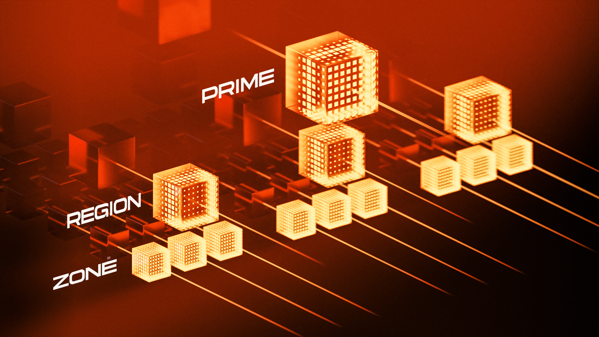

Quai 네트워크는 **작업 증명 보안**, **수평적 확장성**, 그리고 **에너지 기반 화폐(Energy-Based Money)**를 하나로 통합한 차세대 레이어 1 블록체인입니다.

Quai의 핵심에는 네 가지 획기적인 혁신이 자리하고 있습니다.

- **[엔트로피 최소값 증명 (PoEM)](/ko/learn/advanced-introduction/poem/poem) 및 워크셰어:** 블록 경합을 제거하고 이기적 채굴을 무력화하며 병합 채굴된 실행 계층 구조를 조율하는 수학적으로 증명된 작업 증명 합의 메커니즘입니다(워크셰어 연구는 **AFT 2026**에 채택됨).
- **하드머니 가치 저장 수단 ([QUAI](/ko/learn/tokenomics/quai-emissions) + [SOAP](/ko/learn/advanced-introduction/soap)):** [Singularity 및 Polaris 포크](/ko/learn/tokenomics/protocol-upgrades) 이후 **~93%의 유통 공급량**과 **연 4% 미만의 제네시스 인플레이션**을 갖춘 EVM 호환 프로그래밍 가능 하드머니이며, 외부 SHA-256, Scrypt 및 KawPoW 병합 채굴 보조금을 지속적인 100% QUAI 바이백 및 소각으로 전환하는 **Project SOAP**으로 뒷받침됩니다.
- **세계 최초의 분산형 에너지 플랫코인 ([Qi](/ko/learn/tokenomics/flatcoins)):** 채굴 에너지 비용에 따라 발행량이 직접 조정되는 UTXO 기반 디지털 현금으로, 법정화폐 수탁이나 외부 가격 오라클 없이 실질 구매력을 보존합니다.
- **AI 및 컴퓨팅 경제를 위한 네이티브 결제 레일 ([x402 Work & Hashference](/ko/build/x402-and-hashference)):** 인간과 자율 AI 에이전트가 수 초간의 작업 증명, QUAI 또는 Qi로 웹 API와 최첨단 AI 추론 비용을 직접 결제할 수 있게 하는 개방형 HTTP 402 결제 레일입니다.

이러한 혁신이 결합되어 글로벌 인간 상거래와 자율 기계 경제 모두를 위해 설계된 분산형 화폐 및 컴퓨팅 네트워크를 구축합니다.

<CardGroup cols={2}>
  <Card
    title="해방된 작업 증명 확장성"
    icon="arrow-up-right-dots"
    href="#해방된-확장성"
  >
    글로벌 규모에서도 수수료를 낮게 유지하도록 설계된 병합 채굴 계층 구조와 PoEM 합의.
  </Card>
  <Card
    title="하드머니 + SOAP 엔진"
    icon="fire"
    href="/ko/learn/tokenomics/quai-emissions"
  >
    Singularity 및 Polaris를 통해 제네시스 QUAI ~1.90B 영구 소각, 지속적 작업 증명 바이백 지원.
  </Card>
  <Card
    title="에너지 기반 플랫코인 (Qi)"
    icon="bolt"
    href="/ko/learn/tokenomics/flatcoins"
  >
    가치가 하락하는 법정화폐가 아닌 물리적 에너지 비용에 연동된 분산형 디지털 현금.
  </Card>
  <Card
    title="AI 및 머신 결제 (x402)"
    icon="microchip"
    href="/ko/build/x402-and-hashference"
  >
    지갑이나 API 키 없이 작업 증명으로 웹 요청 및 45개 이상의 AI 모델 결제.
  </Card>
</CardGroup>

<Frame>
  
</Frame>

## 해방된 확장성

**Quai는 병합 채굴된 계층 구조를 통해 실행 용량을 확장함으로써 거래 수수료를 영구적으로 낮게 유지합니다.**

Quai를 교통량이 증가할수록 새로운 병렬 차선을 추가하는 고속도로 시스템으로 생각해 보세요. Quai는 [엔트로피 최소값 증명 (PoEM)](/ko/learn/advanced-introduction/poem/poem)을 통해 병렬 실행 체인([실행 샤드](/ko/learn/advanced-introduction/poem/sharding/execution-sharding))을 조율하면서 계층 구조 전체에 완전한 작업 증명 보안을 적용합니다.

주요 이점:
- **동적 확장:** 수요가 증가함에 따라 네트워크가 처리 용량을 확장합니다
- **낮은 수수료:** 병렬 실행으로 단일 체인의 수수료 급등을 방지합니다
- **신뢰 없는 상호운용성:** 샤드는 [채굴자가 검증하는 동시 블록(coincident blocks)](/ko/learn/advanced-introduction/merged-mining/coincident-blocks)을 통해 네이티브하게 연결됩니다
- **다중 알고리즘 작업 증명 보안:** KawPoW 블록과 SHA-256 및 Scrypt 워크셰어의 결합으로 ASIC과 GPU 전반에 걸쳐 물리적 하드웨어 보안을 다각화합니다

## 작업 증명 기반 하드머니 (QUAI + SOAP)

전통적인 작업 증명 체인은 구조적 긴장에 직면해 있습니다. 블록 보상이 네트워크를 보호하지만 동시에 지속적인 채굴자 매도 압력을 유발하기 때문입니다. Quai는 **[Project SOAP](/ko/learn/advanced-introduction/soap)**(보조금 기반 공개시장 매입 프로토콜)과 철저한 공급 규율을 통해 이러한 역학을 반전시킵니다.

- **Singularity 및 Polaris 포크:** 원래 30억 제네시스 토큰 중 **~19억(~1.90B) 개**를 영구 소각하여 유통 공급량 비중을 **~93%**로 높이고, 제네시스 인플레이션을 **연 4% 미만**으로 낮추었으며, 2029년 초까지의 잔여 언락 물량을 **월 ~3.7M QUAI**로 축소했습니다.
- **지속적인 SOAP 바이백 및 소각:** Bitcoin Cash, Litecoin, Dogecoin 및 Ravencoin의 외부 병합 채굴 보조금이 프로토콜 제어 주소로 유입되어 공개시장에서 QUAI를 매수하고 **100% 영구 소각**합니다.

[supply.qu.ai](https://supply.qu.ai) 및 [soap.qu.ai](https://soap.qu.ai)에서 실시간 공급량, 소각량 및 언락 지표를 언제든지 추적할 수 있습니다.

## 에너지 기반 플랫코인 (Qi)

**가치가 하락하는 법정화폐 달러를 추종하거나 중앙화 은행 수탁에 의존하는 기존 스테이블코인과 달리, [Qi](/ko/learn/tokenomics/flatcoins)는 물리적 에너지 비용에서 안정성을 도출합니다.**

작동 방식:
- 작업 증명 채굴이 [실제 에너지 가격에 대한 신뢰 없는 온체인 오라클](/ko/learn/tokenomics/token-dynamics/token-dynamics) 역할을 합니다
- 프로토콜은 채굴 난이도에 비례하여 [Qi 발행량](/ko/learn/tokenomics/qi-emissions)을 선형적으로 조정합니다
- 채굴자 선택과 [온체인 변환](/ko/learn/tokenomics/token-dynamics/conversions)이 실제 수요에 맞춰 Qi 공급량의 균형을 동적으로 유지합니다

에너지는 인간 경제 활동과 인공지능 컴퓨팅 모두에 투입되는 보편적 자원이므로, [플랫코인](/ko/learn/tokenomics/flatcoins)을 에너지에 연동하면 다음을 위해 설계된 중립적인 디지털 현금이 탄생합니다.
- **글로벌 상거래:** 법정화폐 인플레이션 및 검열로부터 보호
- **AI 및 컴퓨팅 경제:** 추론 및 머신 서비스를 이를 구동하는 자원으로 직접 가격 책정
- **일상 결제:** 현금과 같은 [프라이버시 속성](/ko/learn/advanced-introduction/qi-privacy)을 갖춘 고정 액면 UTXO

<Note>
**이것이 중요한 이유**

기존 블록체인은 사용자에게 다음 중 하나를 선택하도록 강요했습니다.
- **작업 증명 보안**(비트코인) 또는 **스마트 컨트랙트 프로그래밍 가능성**(이더리움)
- **분산형 구조** 또는 **대규모 환경에서의 낮은 수수료**
- **하드머니 희소성** 또는 **인플레이션 저항형 디지털 현금**

Quai는 확장 가능한 작업 증명, 하드머니 QUAI, Qi 에너지 플랫코인, 그리고 작업 증명 네이티브 AI 결제 레일을 단일 레이어 1에 통합함으로써 이러한 트레이드오프를 해결합니다.
</Note>

## 탐색할 준비가 되셨나요?

<CardGroup cols={3}>
  <Card
    title="Quai 사용하기"
    icon="rocket"
    href="/ko/learn/use-quai"
  >
    지갑, 거래소, Quainance DeFi, 브리지 및 실시간 도구.
  </Card>
  <Card
    title="Quai Explorer"
    icon="magnifying-glass"
    href="https://explorer.qu.ai"
  >
    메인넷 블록, 워크셰어, 거래 및 스마트 컨트랙트 조회.
  </Card>
  <Card
    title="Supply 대시보드"
    icon="chart-line"
    href="https://supply.qu.ai"
  >
    Polaris 이후 실시간 공급량, 제네시스 소각 및 SOAP 지표 탐색.
  </Card>
  <Card
    title="플랫코인이란 무엇인가?"
    icon="scale-balanced"
    href="/ko/learn/tokenomics/flatcoins"
  >
    Qi가 에너지 기반 플랫코인으로서 구매력을 보존하는 방법 알아보기.
  </Card>
  <Card
    title="x402 Work & Hashference"
    icon="microchip"
    href="/ko/build/x402-and-hashference"
  >
    작업 증명으로 AI 추론 및 HTTP API 비용을 직접 결제하세요.
  </Card>
  <Card
    title="개발 또는 채굴하기"
    icon="code"
    href="/ko/build/introduction"
  >
    EVM 컨트랙트 배포, Quais SDK 통합 또는 go-quai 노드 실행.
  </Card>
</CardGroup>
