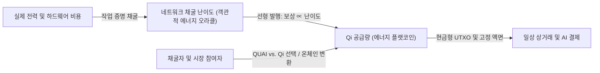

## 플랫코인이란 무엇인가?

**플랫코인(Flatcoin)**은 미국 달러와 같이 가치가 하락하는 법정화폐에 1:1로 페그하는 대신, 시간이 지나도 **실질 구매력을 일정하게(flat) 유지**하도록 설계된 암호화폐입니다.

이 용어는 법정화폐 담보 스테이블코인의 다음 진화 단계를 설명하기 위해 암호화폐 업계(특히 Balaji Srinivasan과 Coinbase Ventures)에서 널리 사용되기 시작했습니다. 스테이블코인은 명목 가격을 `$1.00`에 고정하는 반면, 플랫코인은 1단위가 실제로 *구매할 수 있는 가치*를 안정적으로 유지하여 보유자를 화폐 가치 하락과 인플레이션으로부터 보호하는 것을 목표로 합니다.

<Note>
  **한 문장으로 보는 스테이블코인 vs 플랫코인:** USD 스테이블코인은 가치가 하락하는 정부 통화 단위를 추종합니다(`1 토큰 = $1`, `$1`의 구매력과 무관). 반면 플랫코인은 실제 구매력을 추종합니다(`1 토큰 = 일정한 실질 가치`).
</Note>

## 법정화폐 스테이블코인의 한계

USDC와 USDT 같은 법정화폐 담보 스테이블코인은 암호화폐의 단기 변동성 문제를 해결했지만, 이들이 모방하는 법정화폐 시스템의 세 가지 구조적 결함을 그대로 물려받습니다.

1. **보장된 구매력 잠식:** 법정화폐는 시간이 지남에 따라 인플레이션이 발생하도록 설계되어 있습니다. USD 페그 스테이블코인을 보유한다는 것은 발행자가 준비금 국채에서 얻는 수익률은 전혀 받지 못한 채 달러 가치 하락을 100% 감수하는 것을 의미합니다.
2. **중앙화된 수탁 및 검열 위험:** 법정화폐 준비금은 규제를 받는 은행 계좌와 국채에 보관됩니다. 발행자는 주소를 동결하거나 거래를 블랙리스트에 올릴 수 있으며, 제휴 은행의 파산 위험에 노출될 수 있습니다.
3. **특정 국가 통화 정책에 대한 종속성:** 계산 단위가 단일 중앙은행에 의해 통제되는 한, 법정화폐 스테이블코인은 글로벌 상거래나 자율 AI 에이전트를 위한 진정으로 중립적이고 국경 없는 화폐 역할을 할 수 없습니다.

## 플랫코인을 구축하는 세 가지 접근 방식

인플레이션에 저항하는 화폐를 만들기 위해 여러 설계가 제안되었으며, 각 방식은 뚜렷한 트레이드오프를 가집니다.

| 설계 방식 | 가치 기준 메커니즘 | 핵심 트레이드오프 |
| :--- | :--- | :--- |
| **CPI / 인플레이션 오라클 플랫코인** | 가격 오라클과 담보 볼트를 통해 소비자물가지수(CPI) 바스켓 추종 | 중앙화된 정부 통계(CPI), 외부 오라클, 거버넌스 조정에 의존하므로 신뢰 가정이 다시 도입됩니다. |
| **원자재 / RWA 담보 플랫코인** | 토큰화된 금, 원자재 또는 실물자산(RWA) 바스켓으로 담보 | 실물 수탁 기관, 법적 래퍼, 오프체인 감사가 필요하며 압류 및 거래상대방 위험에 노출됩니다. |
| **에너지 기반 작업 증명 플랫코인 ([Qi](/ko/learn/tokenomics/qi-emissions))** | 물리적 에너지(채굴 난이도)에 비례하여 작업 증명을 통해 직접 발행 | **수탁 기관 제로, 가격 오라클 제로, 법정화폐 담보 제로.** 열역학 법칙과 전력 시장에 직접 연동됩니다. |

## 왜 에너지가 이상적인 화폐 기준인가?

금 준비금이나 정치적 법령이 아닌 물리적 에너지에 화폐를 연동하려는 아이디어는 **Henry Ford**와 **Thomas Edison**의 "에너지 달러(energy dollar)" 제안부터 **Buckminster Fuller**의 "킬로와트 달러(Kilowatt Dollar)"에 이르기까지 한 세기에 걸친 지적 계보를 가지고 있습니다.

에너지는 플랫코인의 기준 단위로서 독보적인 특성을 지닙니다.
- **보편적이고 대체 가능함:** 1킬로와트시(kWh)의 전력은 도쿄, 오스틴, 취리히 어디에서나 물리적으로 동일합니다.
- **정부의 임의 조작 불가능:** 어떤 중앙은행도 줄(joule)을 찍어내거나 열역학 법칙을 바꿀 수 없습니다.
- **실물 경제 산출물과 직접 연결됨:** 모든 실물 재화, 제조 공정, 그리고 **AI 컴퓨팅**의 모든 단위는 에너지를 핵심 투입 요소로 필요로 합니다. 데이터 센터와 자율 AI 에이전트가 주도하는 경제에서 에너지는 *곧* 근본적인 계산 단위입니다.

## Qi가 분산형 에너지 플랫코인으로 작동하는 방식

**Qi**(중국어 气에서 유래, 에너지 또는 생명력을 뜻하며 *"치(chee)"*로 발음)는 Quai 네트워크의 네이티브 에너지 기반 플랫코인으로, Quai의 희소하고 견고한 가치 저장 수단인 [QUAI](/ko/learn/tokenomics/quai-emissions)와 함께 작동합니다.

### Qi의 핵심 특성
- **신뢰 없는 에너지 오라클로서의 작업 증명:** 오프체인 CPI 피드에 의존하는 대신, Quai 프로토콜은 채굴 난이도를 실제 에너지 지출에 대한 직접적이고 위변조가 불가능한 대리지표로 사용합니다. Qi 블록 보상은 난이도에 **선형적으로** 비례하므로, 각 Qi는 시간이 지나도 일관된 물리적 에너지 단위를 나타냅니다.
- **제로 프리마인 / 제로 제네시스 공급량:** Qi는 **초기 공급량 0**으로 출시되었습니다. 유통되는 모든 Qi는 오직 작업 증명 채굴 또는 프로토콜 수준의 [QUAI ↔ Qi 변환](/ko/learn/tokenomics/token-dynamics/conversions)을 통해서만 생성됩니다.
- **수요 반응형 공급량:** 수요 변화에 따라 가격이 크게 출렁이는 고정 상한 가치 저장 자산과 달리, Qi의 공급량은 채굴자의 보상 선택과 온체인 변환을 통해 수요가 증가하면 확장되고 수요가 감소하면 축소됩니다. 이를 통해 수요 충격을 가격이 아닌 공급량으로 흡수합니다.
- **설계 단계부터 내재된 현금형 프라이버시:** 고정 액면과 재사용 불가능한 주소를 갖춘 UTXO 원장([Qi 프라이버시](/ko/learn/advanced-introduction/qi-privacy)) 위에 구축된 Qi는 중앙화된 동결 스위치 없이 실물 디지털 현금처럼 작동합니다.

## 화폐 모델 비교

| 특성 | 법정화폐 스테이블코인 (USDC/USDT) | 알고리즘 스테이블코인 | CPI 오라클 플랫코인 | **Qi (Quai 에너지 플랫코인)** |
| :--- | :--- | :--- | :--- | :--- |
| **가치 기준** | 미국 달러 (법정화폐) | 재귀적 토큰 페그 | 정부 CPI 바스켓 | **실제 에너지 (작업 증명 난이도)** |
| **인플레이션 방어** | 없음 (USD 가치 하락 추종) | 불안정 / 디페그 위험 | CPI 정확도에 의존 | **물리적 에너지 비용에 연동** |
| **담보 / 수탁** | 중앙화 은행 및 국채 | 내생적 / 취약 | 초과 담보 볼트 | **없음 (네이티브 작업 증명 발행)** |
| **오라클 의존성** | 오프체인 은행 증명 | 시장 가격 오라클 | CPI + 가격 오라클 | **없음 (난이도는 네이티브 온체인)** |
| **검열 저항성** | 낮음 (발행자 동결 키) | 중간 | 중간 | **높음 (분산형 작업 증명 + UTXO 프라이버시)** |
| **AI 및 컴퓨팅 적합성** | KYC/은행 레일 필요 | 취약 | 복잡한 DeFi 래퍼 | **작업 증명 및 [x402 Work](/ko/build/x402-and-hashference) 네이티브** |

## 이중 토큰 시너지: 플랫코인 + 하드머니

플랫코인만으로는 구매력을 유지할 뿐, 가치가 상승하는 준비 자산으로서 네트워크 성장을 포착하도록 설계되지 않았습니다. 이것이 Quai가 **Qi**와 **[QUAI](/ko/learn/tokenomics/quai-emissions)**를 결합한 이유입니다.

- **QUAI**는 장기적인 네트워크 성장과 희소성을 포착합니다([Polaris](/ko/learn/tokenomics/protocol-upgrades) 이후 유통 비중 약 93%, 제네시스 인플레이션 연 4% 미만, [SOAP](/ko/learn/advanced-introduction/soap)을 통한 지속적 소각).
- **Qi**는 안정적인 가격 책정, 일상적인 디지털 현금, 머신 투 머신(M2M) 컴퓨팅 결제를 위한 에너지 연동 플랫코인을 제공합니다.
- **온체인 변환**은 중앙화된 브리지나 수탁 발행자 없이 프로토콜 수준에서 두 자산을 직접 연결합니다.

## 더 알아보기

<CardGroup cols={2}>
  <Card title="Qi 발행" icon="bolt" href="/ko/learn/tokenomics/qi-emissions">
    Qi의 난이도 비례 선형 발행 공식과 공급 메커니즘을 살펴보세요.
  </Card>
  <Card title="토큰 역학 및 변환" icon="arrows-rotate" href="/ko/learn/tokenomics/token-dynamics/conversions">
    채굴자와 사용자가 온체인에서 QUAI와 Qi를 변환하는 방법을 알아보세요.
  </Card>
  <Card title="실시간 변환 대시보드" icon="chart-line" href="https://conversions.quai.network/">
    실시간 QUAI ↔ Qi 변환 비율을 확인하세요.
  </Card>
  <Card title="실시간 공급 대시보드" icon="gauge-high" href="https://supply.qu.ai">
    supply.qu.ai에서 QUAI 및 Qi 공급 지표를 실시간으로 추적하세요.
  </Card>
</CardGroup>
