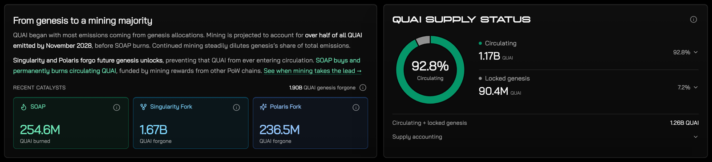

**2025년 2월 4일** 메인넷 출시 이후, Quai 네트워크는 다중 알고리즘 작업 증명 보안을 강화하고 자본 효율성을 높이며 QUAI가 공급 제약형 하드머니 자산으로 전환되는 속도를 앞당기기 위해 체계적인 프로토콜 업그레이드를 실행해 왔습니다.

<CardGroup cols={3}>
  <Card title="Supply 대시보드" icon="chart-line" href="https://supply.qu.ai">
    실시간 유통량, 누적 제네시스 소각량 및 남은 언락 일정을 확인하세요.
  </Card>
  <Card title="SOAP 대시보드" icon="fire" href="https://soap.qu.ai">
    실시간 병합 채굴 보조금 유입과 QUAI 공개시장 소각 현황을 추적하세요.
  </Card>
  <Card title="Quai Explorer" icon="magnifying-glass" href="https://explorer.qu.ai">
    온체인에서 블록, 워크셰어, 거래 및 소각 주소를 직접 검사하세요.
  </Card>
</CardGroup>

## 업그레이드 타임라인

| 업그레이드 | 날짜 | 클라이언트 / 활성화 | 주요 영향 |
| :--- | :--- | :--- | :--- |
| **메인넷 제네시스** | 2025년 2월 4일 | `go-quai` 메인넷 (`chainId: 9`) | PoEM 합의, 이중 토큰 QUAI + Qi 화폐 시스템 및 Cyprus-1 존 출시. |
| **Project SOAP** | 2025년 12월 | 다중 알고리즘 AuxPoW + 워크셰어 | SHA-256 (BCH), Scrypt (LTC/DOGE) + RVN 병합 채굴 지원; 외부 보조금 100%를 QUAI 바이백 및 소각으로 라우팅. |
| **Singularity 포크** | 2026년 3월 19일 | `go-quai v0.51.0` · Prime 블록 `1,530,500` | **1,667,159,984 QUAI**(미래 제네시스 언락의 81.1%) 소각; 블록당 워크셰어 상한을 **16 → 32**로 2배 확대. |
| **SOAP 및 보상 고도화** | 2026년 중반 | `go-quai v0.53.0` – `v0.54.0` | SHA 등가 보상 정규화(네이티브 비트코인 증명을 위한 SOAP 대비) 및 보상·난이도·변환에 대한 장기 EMA 평활화 도입. |
| **Polaris 포크** | 2026년 10월 13일 *(언락 기준일 10월 30일)* | `go-quai v0.57.0` | 창립자 및 Dominant Strategies의 잔여 언락 물량에서 **236,456,538 QUAI** 추가 소각; 유통량 비중 **~93%**로 상승 및 제네시스 인플레이션 **연 4% 미만**으로 축소. |

---

## Polaris 포크 (2026년 10월)

**Polaris 포크**(`go-quai v0.57.0`, 2026년 10월 13일 활성화, 업데이트된 언락 일정은 2026년 10월 30일 이후 확정)는 프로토콜 수준의 주소 스킵을 구현하여 Quai 창립자 및 Dominant Strategies 개발 팀에 배정된 잔여 미래 제네시스 할당량 전액을 영구 소각했습니다.

### 주요 수치 및 구조적 영향

- **영구 소각된 토큰:** 창립자 및 Dominant Strategies가 포기한 **236,456,538 QUAI**.
- **누적 제네시스 소각량 (Singularity + Polaris):** 원래 3,000,000,000 제네시스 할당량에서 **1,903,616,522 QUAI (~1.90B)**가 영구 제거되어 조정된 제네시스 기준선이 **1,096,383,478 QUAI**로 축소.
- **유통 공급량 비중:** 전체 공급량의 **~77% → ~93%**로 즉시 상승.
- **연간 제네시스 인플레이션:** **~13% → 연 4% 미만**으로 대폭 축소.
- **총 연간 인플레이션 (SOAP 반영):** **~18% → 연 9% 미만**으로 감소.
- **월간 제네시스 언락:** **~13M → 월 ~3.7M QUAI**로 급감.
- **잔여 미베스팅 물량(Overhang):** **~327M → ~90.4M QUAI (7.2%)**로 축소되어 **2029년 초**까지 제네시스 베스팅 완료, **2028년 11월** 작업 증명 채굴 비중 과반 도달 궤도에 진입.

<Frame caption="supply.qu.ai에 표시된 Polaris 이후 공급 현황 및 촉매">
	
</Frame>

### Polaris 이전 vs. 이후 비교

| 지표 | Singularity 이전 (출시 시점) | Singularity 이후 (2026년 3월) | Polaris 이후 (2026년 10월) |
| :--- | :--- | :--- | :--- |
| **제네시스 기준선** | 3,000,000,000 QUAI | 1,332,840,016 QUAI | **1,096,383,478 QUAI** |
| **누적 제네시스 소각량** | 0 | 1,667,159,984 QUAI | **1,903,616,522 QUAI** |
| **유통 공급량 비율** | 출시 시 ~31% | ~77% | **~93%** |
| **제네시스 인플레이션 (연간)** | — | ~13% | **&lt; 4%** |
| **총 인플레이션 (SOAP 포함)** | — | ~18% | **&lt; 9%** |
| **월간 언락 물량** | — | ~13M QUAI / 월 | **~3.7M QUAI / 월** |
| **잔여 제네시스 미베스팅 물량** | 2.055B+ QUAI | ~327M QUAI | **~90M QUAI** |

---

## Singularity 포크 (2026년 3월)

2026년 3월 19일 `go-quai v0.51.0`을 통해 **Prime 블록 1,530,500**에서 활성화된 **Singularity 포크**는 Quai의 통화 정책과 워크셰어 처리량을 근본적으로 재편했습니다.

1. **다자간 제네시스 소각:** 투자자, Dominant Strategies 및 Quai Foundation은 잔여 미래 제네시스 언락의 81.1%에 해당하는 **1,667,159,984 QUAI**를 자발적으로 건너뛰고 영구 소각하기로 합의하여, 베스팅 제네시스 기준선을 **3,000,000,000 QUAI**에서 **1,332,840,016 QUAI**로 낮췄습니다.
2. **워크셰어 포함 상한 2배 확대 (16 → 32):** [Project SOAP](/ko/learn/advanced-introduction/soap) 하에서 외부 작업 증명 참여와 노드 자본 효율성을 높이기 위해 `v0.51.0`은 블록당 워크셰어 상한을 2배로 늘렸습니다.
   - **블록당 총 워크셰어:** `16` → **`32`**
   - **블록당 SHA-256 워크셰어:** `8` → **`16`**
   - **블록당 Scrypt 워크셰어:** `8` → **`16`**
3. **표준 공급 공식 확립:** [supply.qu.ai](https://supply.qu.ai)에서 실시간으로 추적되는 투명한 공급 프레임워크를 확립했습니다.
   $$\text{Total Supply} = \text{Genesis Unlocks} + \text{Mining Emissions} - \text{SOAP Burns}$$

---

## 중간 클라이언트 고도화 (`v0.52.0` – `v0.55.0`)

Singularity와 Polaris 사이에 배포된 `go-quai` 릴리스들은 SOAP 경제학과 보상 안정성을 강화했습니다.

- **`v0.52.0`:** 메인넷 API 안정성 및 Singularity 이후 RPC 개선.
- **`v0.53.0`:** **SHA 등가 보상 정규화(SHA-equivalent reward normalizations)**를 도입하여 BCH, LTC, DOGE, RVN과 함께 네이티브 비트코인 증명 구조를 수용할 수 있도록 SOAP의 AuxPoW 회계 처리를 준비.
- **`v0.54.0`:** 블록 보상, 난이도 조정 및 QUAI ↔ Qi 변환 역학을 매끄럽게 하기 위해 더 긴 **지수 이동 평균(EMA)**을 구현.
- **`v0.55.0`:** Polaris(`v0.57.0`)를 앞둔 지속적인 노드 동기화 및 인프라 최적화.

---

## Project SOAP (2025년 12월)

2025년 12월 출시된 **보조금 기반 공개시장 매입 프로토콜(SOAP, Subsidized Open-market Acquisition Protocol)**은 Quai를 단일 알고리즘 GPU 체인에서 KawPoW GPU와 SHA-256 및 Scrypt ASIC이 함께 보안을 제공하는 다중 알고리즘 작업 증명 네트워크로 전환했습니다. 병합 채굴된 부모 체인 보상이 매도 압력을 유발하도록 두는 대신, SOAP은 부모 체인 코인베이스 보조금의 **100%**를 프로토콜 제어 주소로 라우팅하여 공개시장에서 QUAI를 매수하고 영구 소각합니다.

자세한 내용은 [Project SOAP 기술 개요](/ko/learn/advanced-introduction/soap)에서 확인하고, [soap.qu.ai](https://soap.qu.ai)에서 실시간 소각 현황을 추적하세요.
