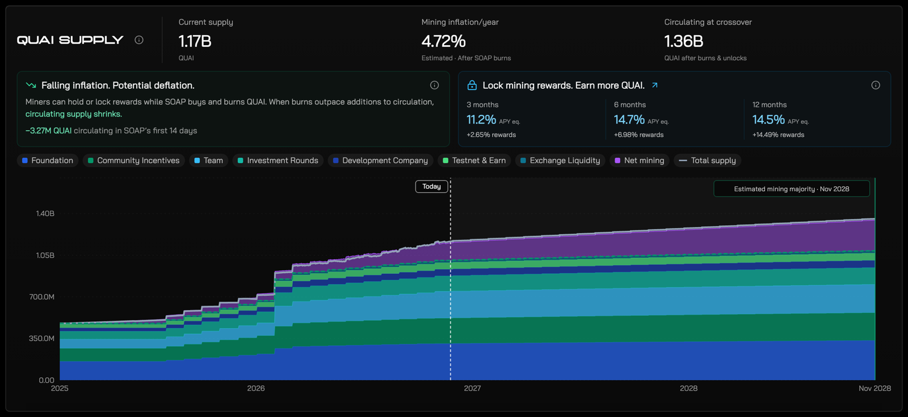
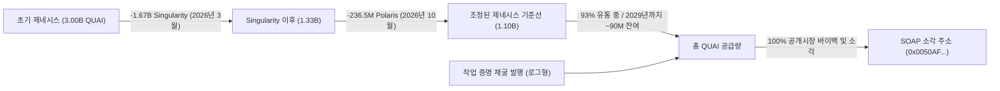
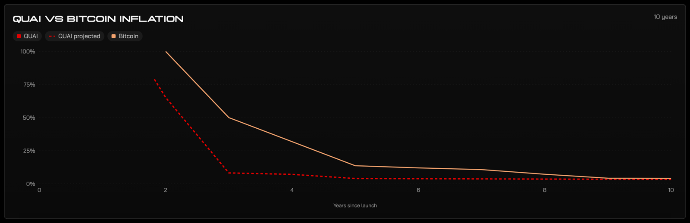
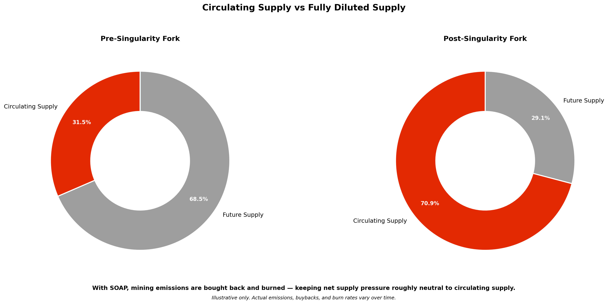

## 발행 개요

QUAI 공급량은 하나의 투명한 방정식에 따라 변화합니다.

$$
\text{Total Supply} = \text{Genesis Unlocks} + \text{Mining Emissions} - \text{SOAP Burns}
$$

세 가지 주요 프로토콜 마일스톤이 QUAI의 하드머니 공급 궤적을 정의합니다.

- **[Singularity 포크](/ko/learn/tokenomics/protocol-upgrades#singularity-포크-2026년-3월) (2026년 3월, `go-quai v0.51.0`):** 투자자, Dominant Strategies 및 Quai Foundation 간의 다자간 합의를 통해 **1,667,159,984 QUAI**(미래 제네시스 언락의 81.1%)를 영구 소각하여, 베스팅 제네시스 기준선을 **3,000,000,000 QUAI**에서 **1,332,840,016 QUAI**로 낮췄습니다.
- **[Polaris 포크](/ko/learn/tokenomics/protocol-upgrades#polaris-포크-2026년-10월) (2026년 10월, `go-quai v0.57.0`):** Quai 창립자와 Dominant Strategies 팀이 잔여 미래 제네시스 할당량에서 **236,456,538 QUAI**를 추가로 영구 소각하여 누적 제네시스 소각량을 **1,903,616,522 QUAI (~1.90B)**로 늘리고 조정된 제네시스 기준선을 **1,096,383,478 QUAI**로 축소했습니다.
- **[Project SOAP](/ko/learn/advanced-introduction/soap) (2025년 12월 – 진행 중):** 외부 병합 채굴 작업 증명 보조금(BCH, LTC, DOGE, RVN)의 100%를 지속적인 공개시장 QUAI 매입으로 라우팅하여 **100% 영구 소각**합니다—현재까지 **254.6M QUAI 이상**이 소각되었습니다.

<Frame caption="supply.qu.ai 기준 Polaris 이후 실시간 QUAI 공급 현황 및 주요 촉매 (2026년 11월)">
	
</Frame>

<CardGroup cols={3}>
  <Card title="실시간 Supply 대시보드" icon="chart-line" href="https://supply.qu.ai">
    supply.qu.ai에서 실시간 유통량, 제네시스 소각, 채굴 발행 및 언락 일정을 추적하세요.
  </Card>
  <Card title="SOAP 소각 대시보드" icon="fire" href="https://soap.qu.ai">
    실시간 병합 채굴 보조금 유입 및 누적 QUAI 바이백·소각 현황을 모니터링하세요.
  </Card>
  <Card title="탐색기의 소각 주소" icon="magnifying-glass" href="https://explorer.qu.ai/address/0x0050AF0000000000000000000000000000000000">
    explorer.qu.ai를 통해 온체인에서 영구 소각된 QUAI를 직접 확인하세요.
  </Card>
</CardGroup>

## Polaris 이후 공급 스냅샷

Polaris 포크(2026년 10월 13일 활성화, 10월 30일 기준일 이후 언락 일정 적용)는 장기적인 내부자 미베스팅 물량 부담(overhang)을 해소하고 QUAI가 성숙한 공급 제약형 하드머니 자산으로 전환되는 속도를 앞당겼습니다.

| 지표 | Polaris 이전 (Singularity 이후) | Polaris 이후 (현재) |
| :--- | :--- | :--- |
| **초기 제네시스 할당량** | 3,000,000,000 QUAI | 3,000,000,000 QUAI |
| **누적 제네시스 소각량** | 1,667,159,984 QUAI | **1,903,616,522 QUAI (~1.90B)** |
| **조정된 제네시스 기준선** | 1,332,840,016 QUAI | **1,096,383,478 QUAI** |
| **유통 공급량 비중** | ~77% | **~92.8% (1.17B QUAI)** |
| **연간 제네시스 인플레이션** | 연 ~13% | **연 4% 미만 (&lt; 4%)** |
| **순 채굴 인플레이션 (SOAP 소각 반영)** | — | **연 ~4.72%** *(추정)* |
| **총 네트워크 인플레이션 (SOAP 포함)** | 연 ~18% | **연 9% 미만 (&lt; 9%)** |
| **월간 제네시스 언락** | 월 ~13M QUAI | **월 ~3.7M QUAI** *(유통량 대비 ~0.32%; 2027년 5월부터 3.6M)* |
| **잔여 잠금 제네시스 물량** | ~327M QUAI | **~90.4M QUAI (7.2%)** *(2029년 초 베스팅 완료)* |
| **누적 SOAP 소각량** | — | **254.6M+ QUAI** |

<Frame caption="2028년 11월 채굴 비중 과반 도달까지의 Polaris 이후 QUAI 공급 궤적 (supply.qu.ai)">
	
</Frame>

<Note>
  실시간 유통 공급량, 누적 SOAP 소각량 및 일일 발행 내역은 항상 [supply.qu.ai](https://supply.qu.ai)를 참조하세요. 포크별 전체 내역은 [프로토콜 업그레이드](/ko/learn/tokenomics/protocol-upgrades)를 확인하세요.
</Note>

**하드머니 궤적:** 잔여 제네시스 언락이 점차 종료되고(2029년 초 완전 베스팅을 향해 월 ~3.7M QUAI 수준) SOAP 바이백이 채굴 발행을 상쇄함에 따라 순 공급 증가율은 0을 향해 수렴하며, SOAP 소각량이 신규 채굴된 QUAI를 초과할 때마다 순 디플레이션 상태가 될 수 있습니다.

## 토큰 발행의 재고

전통적인 암호화폐는 고정된 시간 기반 발행 일정을 사용합니다. 비트코인의 2,100만 개 상한선이 가장 잘 알려진 예입니다. 예측 가능하기는 하지만, 경직된 일정은 변화하는 수요나 해시파워에 대응할 수 없어 호황-불황 주기를 증폭시킬 수 있습니다.

가치 저장 토큰의 경우, 지속 가능한 가치 창출을 위해서는 공급 증가율이 네트워크 채택 성장률보다 낮게 유지되어야 합니다. 임의적인 달력 기반 절벽(cliff)에만 의존하는 대신, Quai는 다음 세 가지를 결합합니다.

- **로그형 채굴 발행:** QUAI 블록 보상은 네트워크 난이도 상승에 반비례하여 조정되므로, 해시레이트와 채택이 확대됨에 따라 발행량이 자연스럽게 감속됩니다.
- **이중 토큰 유연성:** 채굴자는 [QUAI](/ko/learn/tokenomics/quai-emissions)(희소한 가치 저장 수단) 또는 [Qi](/ko/learn/tokenomics/qi-emissions)(에너지 기반 [플랫코인](/ko/learn/tokenomics/flatcoins)) 중 보상을 선택할 수 있어 희소성과 결제 유동성의 균형을 동적으로 유지합니다.
- **SOAP 공개시장 소각:** 외부 작업 증명 보조금이 유통 중인 QUAI를 지속적으로 매수하고 소각하여 영구적인 수요 연동형 공급 소멸 메커니즘을 구축합니다.

## 네트워크 가치 이론 및 발행 설계

네트워크 시스템은 일반적으로 두 가지 성장 단계를 거칩니다.
- **초기 단계:** 네트워크 효과에 의해 주도되는 빠른 $n^2$ 확장
- **성숙 단계:** 효율성 향상에 의해 주도되는 안정적인 $n \log(n)$ 확장

Quai의 적응형 채굴 발행은 해시레이트, 난이도 및 사용량과 같은 실제 네트워크 조건에 맞춰 작동하며 세 가지 이점을 제공합니다.
- **적응형 공급:** 프로토콜 발행량이 채굴 난이도와 수요에 직접 반응합니다.
- **효율적 배분:** 자본과 보안 보상이 가장 생산적인 곳으로 흐릅니다.
- **공급 충격 완화:** 시장을 불안정하게 만드는 급격한 언락 절벽 없이 통제되고 투명한 발행 곡선을 유지합니다.

## QUAI 발행 분배 및 비트코인 대비 인플레이션 비교

QUAI는 공정하고 채굴 중심적인 하드 자산으로 수렴하도록 설계되었습니다. Singularity 및 Polaris 포크를 통해 **~19억(~1.90B)** 제네시스 토큰이 영구 소각되었고 전체 공급량의 **~92.8%**가 이미 유통 중인 상황에서, 누적 작업 증명 채굴 보상은 **2028년 11월**경 언락된 제네시스 할당량을 넘어설 것으로 전망되며(교차 시점 유통량 약 ~1.36B QUAI), 2030년 말에는 전체 발행량의 **~62.6%**(SOAP 소각 전 기준)를 차지할 것으로 예측됩니다.

<Frame caption="10년 인플레이션 궤적 비교: QUAI(Polaris + SOAP 이후) vs. 비트코인 (supply.qu.ai)">
	
</Frame>

유통 공급량, 제네시스 언락, 잠금 채굴 APY 및 SOAP 소각에 대한 실시간 업데이트 차트는 [supply.qu.ai](https://supply.qu.ai)에서 확인하세요.

## SOAP 바이백 및 소각

[Project SOAP](/ko/learn/advanced-introduction/soap)이 활성화된 상태에서 외부 작업 증명 부모 체인(BCH, LTC, DOGE, RVN)의 병합 채굴 보조금은 AuxPoW 커밋먼트를 통해 프로토콜 수준에서 프로토콜 제어 주소로 라우팅된 뒤, 공개시장에서 QUAI로 전환되어 **100% 영구 소각**됩니다.

실제 작동 방식:
- 외부 체인 보조금이 AuxPoW 워크셰어 커밋먼트를 통해 프로토콜 수준에서 포착됩니다.
- 해당 보조금으로 공개시장에서 QUAI를 지속적으로 매수합니다.
- 매수한 QUAI의 **100%**가 소각 주소([`0x0050AF0000000000000000000000000000000000`](https://explorer.qu.ai/address/0x0050AF0000000000000000000000000000000000))로 전송되어 유통 공급량을 영구적으로 줄입니다.

전체 기술적 설계(워크셰어, AuxPoW 검증, 위원회 거버넌스 및 보상 흐름)는 [Project SOAP](/ko/learn/advanced-introduction/soap)에서 확인하세요. 실시간 소각 지표는 [soap.qu.ai](https://soap.qu.ai) 및 [supply.qu.ai](https://supply.qu.ai)를 방문하세요.

<Frame>
	
</Frame>

<AccordionGroup>
<Accordion title="과거 제네시스 기준선 (Singularity / Polaris 이전)">

**Singularity 포크**(2026년 3월)와 **Polaris 포크**(2026년 10월) 이전, Quai는 **3,000,000,000 QUAI**의 초기 베스팅 제네시스 기준선으로 출시되었습니다. 총 **1,903,616,522 QUAI**에 달하는 두 차례의 프로토콜 수준 소각을 통해 해당 기준선은 **1,096,383,478 QUAI**로 영구 축소되었습니다.

<Frame>
	
</Frame>

<Note>
  위 차트는 초기 **Singularity 포크** 감축(3.00B → 1.33B)을 반영합니다. 이후 **Polaris 포크**에서 창립자 및 Dominant Strategies의 잔여 언락 물량 **236,456,538 QUAI**가 추가로 소각되어 조정된 제네시스 기준선이 **1,096,383,478 QUAI**가 되었습니다. Polaris 이후 실시간 차트는 [supply.qu.ai](https://supply.qu.ai)에서 확인하세요.
</Note>

### 초기 출시 언락 일정 (Singularity 및 Polaris로 대체됨)
| 항목 | 초기 일정 |
| :--- | :--- |
| **팀 (16%)** | 1년 클리프, 36개월간 월별 언락 (1–4년차) *(잔여 창립자/팀 언락은 Polaris에서 소각됨)* |
| **투자 라운드 (14%)** | 시드 1 (10%): TGE 25%, 1년 클리프, 36개월 선형 · 시드 2 (2%): 1년 클리프, 클리프 시점 25%, 36개월 선형 · 전략적 (2%): TGE 25%, 1년 클리프, 36개월 선형 |
| **개발 회사 (6%)** | TGE 25%, 6개월 클리프, 42개월간 월별 언락 *(잔여 언락은 Singularity 및 Polaris에서 소각됨)* |
| **재단 준비금 (33%)** | TGE 2%, 6개월 클리프, 66개월간 월별 언락 *(대부분 Singularity에서 소각됨)* |
| **커뮤니티 인센티브 (23%)** | TGE 15%, 6개월 클리프, 42개월간 월별 언락 |
| **테스트넷 및 적립 프로그램 (5%)** | 적립 웨이브 1 및 테스트넷 보상: TGE 100% · 웨이브 2 및 3: 초기 25%, 24개월 선형 |
| **거래소 / 마켓 메이킹 (2%)** | TGE에서 100% 이용 가능 |

</Accordion>

<Accordion title="발행 메커니즘 심층 분석">

QUAI 공급량은 제네시스 언락, 작업 증명 채굴 발행, 그리고 SOAP 바이백 및 소각 흐름에 의해 결정됩니다.

더 깊은 기술 메커니즘 살펴보기:
- [프로토콜 업그레이드 (Singularity & Polaris)](/ko/learn/tokenomics/protocol-upgrades)
- [블록 보상](/ko/learn/tokenomics/token-dynamics/block-rewards)
- [변환 (QUAI ↔ Qi)](/ko/learn/tokenomics/token-dynamics/conversions)
- [난이도 조정](/ko/learn/tokenomics/token-dynamics/difficulty-adjustments)

</Accordion>
</AccordionGroup>
