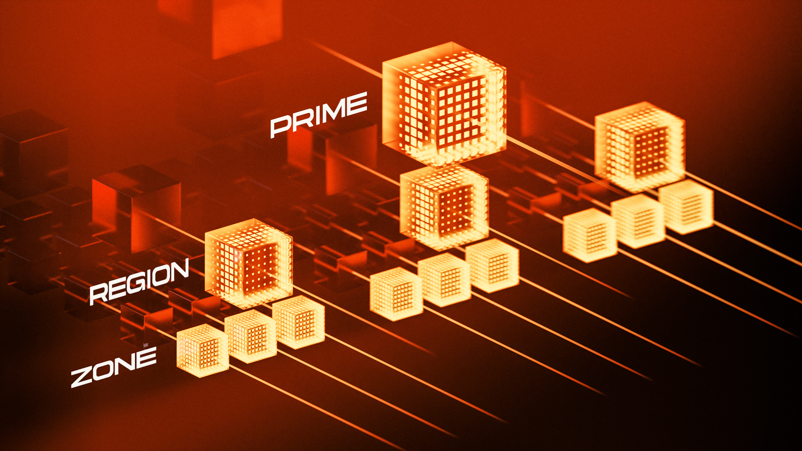

Quai Network is a next-generation Layer-1 blockchain that unites **Proof-of-Work security** with **horizontal scalability** and **Energy-Based Money**.

At its core, Quai brings together four breakthrough innovations:

- **[Proof-of-Entropy-Minima (PoEM)](/learn/advanced-introduction/poem/poem) & Workshares:** A mathematically proven PoW consensus mechanism (with workshare research accepted to **AFT 2026**) that eliminates block contention, neutralizes selfish mining, and coordinates a merged-mined execution hierarchy.
- **Hard-Money Store of Value ([QUAI](/learn/tokenomics/quai-emissions) + [SOAP](/learn/advanced-introduction/soap)):** EVM-compatible programmable hard money—with **~93% circulating supply** and **&lt;4% annual genesis inflation** following the [Singularity & Polaris forks](/learn/tokenomics/protocol-upgrades), reinforced by **Project SOAP**, which turns external SHA-256, Scrypt, and KawPoW merge-mining subsidies into continuous 100% QUAI buybacks and burns.
- **The World's First Decentralized Energy Flatcoin ([Qi](/learn/tokenomics/flatcoins)):** UTXO-based digital cash whose issuance scales directly with mining energy cost—preserving real purchasing power without fiat custody or external price oracles.
- **Native Payment Rails for the AI & Compute Economy ([x402 Work & Hashference](/build/x402-and-hashference)):** Open HTTP 402 payment rails allowing humans and autonomous AI agents to pay for web APIs and frontier AI inference directly with seconds of Proof-of-Work, QUAI, or Qi.

Together, these innovations create a decentralized monetary and compute network built for both global human commerce and autonomous machine economies.

<CardGroup cols={2}>
  <Card
    title="Unleashed PoW Scalability"
    icon="arrow-up-right-dots"
    href="#unleashed-scalability"
  >
    Merged-mined hierarchy and PoEM consensus engineered to keep fees low at global scale.
  </Card>
  <Card
    title="Hard Money + SOAP Engine"
    icon="fire"
    href="/learn/tokenomics/quai-emissions"
  >
    ~1.90B genesis QUAI permanently burned across Singularity & Polaris, backed by continuous PoW buybacks.
  </Card>
  <Card
    title="Energy-Based Flatcoin (Qi)"
    icon="bolt"
    href="/learn/tokenomics/flatcoins"
  >
    Decentralized digital cash anchored to physical energy costs—not depreciating fiat.
  </Card>
  <Card
    title="AI & Machine Payments (x402)"
    icon="microchip"
    href="/build/x402-and-hashference"
  >
    Pay for web requests and 45+ AI models via Proof-of-Work with zero wallets or API keys.
  </Card>
</CardGroup>

<Frame>
  
</Frame>

## Unleashed Scalability

**Quai keeps transaction fees permanently low by expanding execution capacity through a merged-mined hierarchy.**

Think of Quai as a highway system that adds new parallel lanes as traffic grows. Through [Proof-of-Entropy-Minima (PoEM)](/learn/advanced-introduction/poem/poem), Quai coordinates parallel execution chains ([execution shards](/learn/advanced-introduction/poem/sharding/execution-sharding)) while applying full Proof-of-Work security across the hierarchy.

Key benefits:
- **Dynamic scaling:** The network expands processing capacity as demand grows
- **Low fees:** Parallel execution prevents monolithic fee spikes
- **Trustless interoperability:** Shards are natively linked through [miner-validated coincident blocks](/learn/advanced-introduction/merged-mining/coincident-blocks)
- **Multi-algorithm PoW security:** KawPoW blocks combined with SHA-256 and Scrypt workshares diversify physical hardware security across ASICs and GPUs

## Hard Money Powered by Proof-of-Work (QUAI + SOAP)

Traditional Proof-of-Work chains face a structural tension: block rewards secure the network but create continuous miner sell pressure. Quai inverts this dynamic with **[Project SOAP](/learn/advanced-introduction/soap)** (Subsidized Open-market Acquisition Protocol) and aggressive supply discipline:

- **Singularity & Polaris Forks:** Permanently burned **~1.90 billion** of the original 3 billion genesis tokens, raising circulating supply to **~93%**, cutting genesis inflation to **&lt;4%/yr**, and shrinking remaining unlocks to **~3.7M QUAI/month** through early 2029.
- **Continuous SOAP Buyback & Burn:** External merge-mining subsidies from Bitcoin Cash, Litecoin, Dogecoin, and Ravencoin flow into protocol-controlled addresses that buy QUAI on the open market and **burn 100% permanently**.

Track live supply, burns, and unlock metrics anytime at [supply.qu.ai](https://supply.qu.ai) and [soap.qu.ai](https://soap.qu.ai).

## Energy-Based Flatcoin (Qi)

**Unlike traditional stablecoins that track a depreciating fiat dollar or rely on centralized bank custody, [Qi](/learn/tokenomics/flatcoins) derives its stability from the physical cost of energy.**

How it works:
- Proof-of-Work mining acts as a trustless, on-chain [oracle for real-world energy prices](/learn/tokenomics/token-dynamics/token-dynamics)
- The protocol scales [Qi issuance](/learn/tokenomics/qi-emissions) linearly with mining difficulty
- Miner selection and [on-chain conversions](/learn/tokenomics/token-dynamics/conversions) dynamically balance Qi supply with real demand

Because energy is the universal input to both human economic activity and artificial intelligence compute, anchoring a [flatcoin](/learn/tokenomics/flatcoins) to energy creates neutral digital cash built for:
- **Global commerce:** Protection from fiat inflation and censorship
- **AI & compute economies:** Pricing inference and machine services in the resource that powers them
- **Everyday payments:** Fixed-denomination UTXOs with cash-like [privacy properties](/learn/advanced-introduction/qi-privacy)

<Note>
**Why This Matters**

Legacy blockchains force users to choose between:
- **Proof-of-Work security** (Bitcoin) or **smart-contract programmability** (Ethereum)
- **Decentralization** or **low fees at scale**
- **Hard-money scarcity** or **inflation-resistant digital cash**

Quai resolves these tradeoffs on one Layer-1—uniting scalable PoW, hard-money QUAI, the Qi energy flatcoin, and PoW-native AI payment rails.
</Note>

## Ready to Explore?

<CardGroup cols={3}>
  <Card
    title="Use Quai"
    icon="rocket"
    href="/learn/use-quai"
  >
    Wallets, exchanges, Quainance DeFi, bridging, and live tools.
  </Card>
  <Card
    title="Quai Explorer"
    icon="magnifying-glass"
    href="https://explorer.qu.ai"
  >
    Inspect mainnet blocks, workshares, transactions, and smart contracts.
  </Card>
  <Card
    title="Supply Dashboard"
    icon="chart-line"
    href="https://supply.qu.ai"
  >
    Explore live post-Polaris supply, genesis burns, and SOAP metrics.
  </Card>
  <Card
    title="What Are Flatcoins?"
    icon="scale-balanced"
    href="/learn/tokenomics/flatcoins"
  >
    Learn how Qi preserves purchasing power as an energy-backed flatcoin.
  </Card>
  <Card
    title="x402 Work & Hashference"
    icon="microchip"
    href="/build/x402-and-hashference"
  >
    Pay for AI inference and HTTP APIs directly with Proof-of-Work.
  </Card>
  <Card
    title="Build or Mine"
    icon="code"
    href="/build/introduction"
  >
    Deploy EVM contracts, integrate Quais SDK, or run a go-quai node.
  </Card>
</CardGroup>
