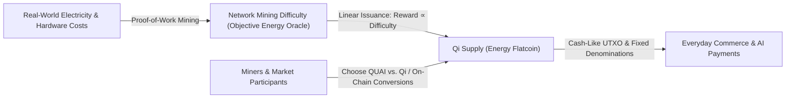

## What Is a Flatcoin?

A **flatcoin** is a cryptocurrency engineered to maintain **flat real purchasing power** over time—rather than maintaining a 1:1 peg to a depreciating fiat currency like the US dollar.

The term was popularized across the crypto industry (notably by Balaji Srinivasan and Coinbase Ventures) to describe the next evolution beyond fiat-backed stablecoins. While a stablecoin keeps its nominal price fixed at `$1.00`, a flatcoin aims to keep what one unit can actually *buy* stable—protecting holders from monetary debasement and inflation.

<Note>
  **Stablecoin vs. Flatcoin in one sentence:** A USD stablecoin tracks a depreciating government unit (`1 token = $1`, regardless of what `$1` buys); a flatcoin tracks real-world purchasing power (`1 token = constant real value`).
</Note>

## Why Fiat Stablecoins Fall Short

Fiat-backed stablecoins like USDC and USDT solved short-term volatility in crypto, but they inherit three structural flaws from the fiat system they mirror:

1. **Guaranteed purchasing-power erosion:** Fiat currencies are designed to inflate over time. Holding a USD-pegged stablecoin means absorbing 100% of dollar debasement with none of the yield earned by the issuer on reserve treasuries.
2. **Centralized custody and censorship risk:** Fiat reserves sit in regulated bank accounts and Treasury bills. Issuers can freeze addresses, blacklist transactions, or face banking-partner failures.
3. **Sovereign monetary dependence:** A fiat stablecoin cannot serve as truly neutral, borderless money for global commerce or autonomous AI agents when its unit of account is controlled by a single central bank.

## Three Approaches to Building a Flatcoin

Several designs have been proposed to create an inflation-resistant currency, each with distinct tradeoffs:

| Design | Anchor Mechanism | Core Tradeoff |
| :--- | :--- | :--- |
| **CPI / Inflation-Oracle Flatcoins** | Tracks a Consumer Price Index (CPI) basket via price oracles and collateral vaults | Depends on centralized government statistics (CPI), external oracles, and governance adjustments—reintroducing trust assumptions. |
| **Commodity / RWA-Backed Flatcoins** | Backed by tokenized gold, commodities, or real-world asset baskets | Requires physical custodians, legal wrappers, and off-chain audits; subject to seizure and counterparty risk. |
| **Energy-Backed PoW Flatcoins ([Qi](/learn/tokenomics/qi-emissions))** | Issued directly via Proof-of-Work in proportion to physical energy (mining difficulty) | **Zero custodians, zero price oracles, zero fiat collateral.** Anchored directly to thermodynamics and electricity markets. |

## Why Energy Is the Ideal Monetary Anchor

The idea of anchoring money to physical energy—rather than gold reserves or political decree—has a century-long intellectual lineage, from **Henry Ford** and **Thomas Edison's** "energy dollar" proposals to **Buckminster Fuller's** "Kilowatt Dollar."

Energy is uniquely suited as the reference unit for a flatcoin:
- **Universal and fungible:** A kilowatt-hour of electricity is physically identical in Tokyo, Austin, and Zurich.
- **Non-arbitrable by governments:** No central bank can print joules or alter the laws of thermodynamics.
- **Directly tied to real economic output:** Every physical good, manufacturing process, and unit of **AI compute** requires energy as its primary input. In an economy increasingly driven by data centers and autonomous AI agents, energy *is* the fundamental unit of account.

## How Qi Works as a Decentralized Energy Flatcoin

**Qi** (pronounced *"chee"*, from the Chinese character 气 for energy or life force) is Quai Network's native energy-backed flatcoin—operating alongside [QUAI](/learn/tokenomics/quai-emissions) (Quai's scarce, hard-money store of value).

### Core Properties of Qi
- **Proof-of-Work as a trustless energy oracle:** Instead of relying on off-chain CPI feeds, Quai's protocol uses mining difficulty as a direct, tamper-proof proxy for real-world energy expenditure. Qi block rewards scale **linearly** with difficulty—so each Qi represents a consistent unit of physical energy over time.
- **Zero premine / zero genesis supply:** Qi launched with **0 initial supply**. Every Qi in circulation enters exclusively through Proof-of-Work mining or protocol-level [QUAI ↔ Qi conversions](/learn/tokenomics/token-dynamics/conversions).
- **Demand-responsive supply:** Unlike fixed-cap store-of-value assets (which swing wildly in price as demand changes), Qi's supply expands when demand rises and contracts when demand falls through miner reward selection and on-chain conversions—absorbing demand shocks in supply rather than price.
- **Cash-like privacy by design:** Built on a UTXO ledger with fixed denominations and non-reusable addresses ([Qi Privacy](/learn/advanced-introduction/qi-privacy)), Qi behaves like physical digital cash without centralized freeze switches.

## Comparing Monetary Models

| Property | Fiat Stablecoins (USDC/USDT) | Algorithmic Stablecoins | CPI-Oracle Flatcoins | **Qi (Quai Energy Flatcoin)** |
| :--- | :--- | :--- | :--- | :--- |
| **Value Anchor** | US Dollar (fiat) | Reflexive token peg | Government CPI basket | **Real-world energy (PoW difficulty)** |
| **Inflation Protection** | None (tracks USD debasement) | Unstable / depeg risk | Dependent on CPI accuracy | **Anchored to physical energy cost** |
| **Collateral / Custodians** | Centralized banks & T-bills | Endogenous / fragile | Over-collateralized vaults | **None (native PoW issuance)** |
| **Oracle Dependency** | Off-chain bank attestations | Market price oracles | CPI + price oracles | **None (difficulty is native on-chain)** |
| **Censorship Resistance** | Low (issuer freeze keys) | Medium | Medium | **High (decentralized PoW + UTXO privacy)** |
| **Built for AI & Compute** | Requires KYC/bank rails | Fragile | Complex DeFi wrappers | **Native to PoW & [x402 Work](/build/x402-and-hashference)** |

## Two-Token Synergy: Flatcoin + Hard Money

A flatcoin alone is designed to hold purchasing power—not to capture network growth as an appreciating reserve asset. That is why Quai pairs **Qi** with **[QUAI](/learn/tokenomics/quai-emissions)**:

- **QUAI** captures long-term network growth and scarcity (post-[Polaris](/learn/tokenomics/protocol-upgrades), ~93% circulating, &lt;4% genesis inflation, continuously burned via [SOAP](/learn/advanced-introduction/soap)).
- **Qi** provides an energy-anchored flatcoin for stable pricing, everyday digital cash, and machine-to-machine compute payments.
- **On-chain conversions** connect both assets directly at the protocol level without centralized bridges or custodial issuers.

## Continue Exploring

<CardGroup cols={2}>
  <Card title="Qi Emissions" icon="bolt" href="/learn/tokenomics/qi-emissions">
    Explore Qi's linear difficulty-proportional issuance formula and supply mechanics.
  </Card>
  <Card title="Token Dynamics & Conversions" icon="arrows-rotate" href="/learn/tokenomics/token-dynamics/conversions">
    Learn how miners and users convert between QUAI and Qi on-chain.
  </Card>
  <Card title="Live Conversions Dashboard" icon="chart-line" href="https://conversions.quai.network/">
    Check real-time QUAI ↔ Qi conversion rates.
  </Card>
  <Card title="Live Supply Dashboard" icon="gauge-high" href="https://supply.qu.ai">
    Track QUAI and Qi supply metrics live on supply.qu.ai.
  </Card>
</CardGroup>
