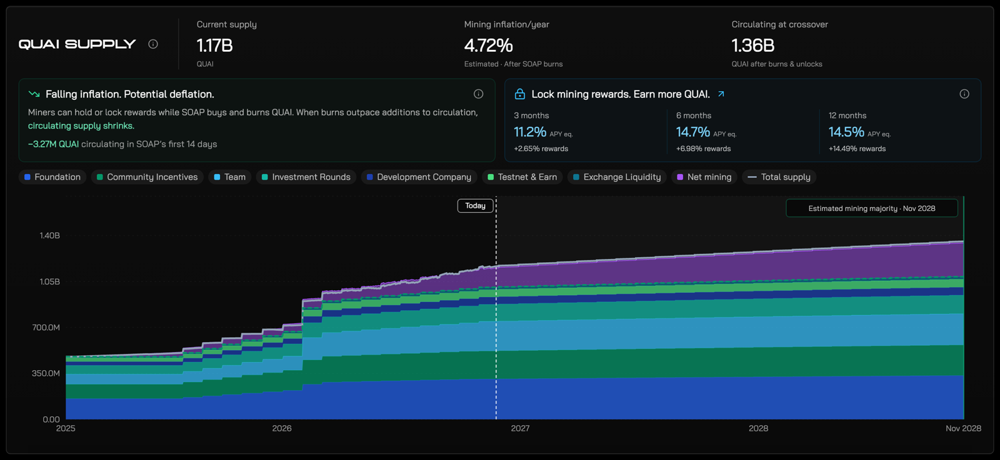
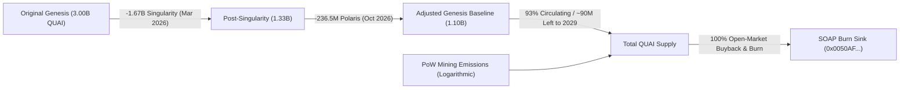
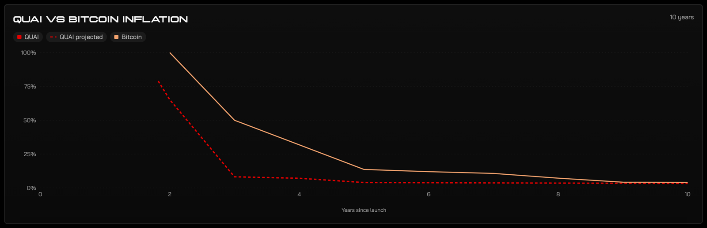
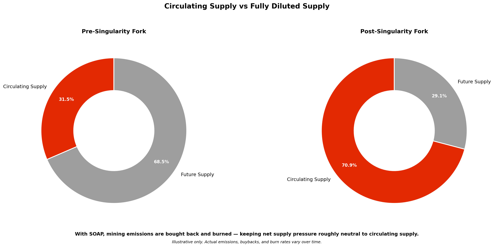

## Emissions Overview

QUAI supply evolves according to a single transparent equation:

$$
\text{Total Supply} = \text{Genesis Unlocks} + \text{Mining Emissions} - \text{SOAP Burns}
$$

Three major protocol milestones define QUAI's hard-money supply trajectory:

- **[Singularity Fork](/learn/tokenomics/protocol-upgrades#singularity-fork-march-2026) (March 2026, `go-quai v0.51.0`):** Permanently burned **1,667,159,984 QUAI** (81.1% of future genesis unlocks) via a multilateral agreement between investors, Dominant Strategies, and the Quai Foundation, lowering the vested genesis baseline from **3,000,000,000 QUAI** to **1,332,840,016 QUAI**.
- **[Polaris Fork](/learn/tokenomics/protocol-upgrades#polaris-fork-october-2026) (October 2026, `go-quai v0.57.0`):** Quai founders and the Dominant Strategies team permanently burned an additional **236,456,538 QUAI** from their remaining future genesis allocations—bringing cumulative genesis burns to **1,903,616,522 QUAI (~1.90B)** and cutting the adjusted genesis baseline to **1,096,383,478 QUAI**.
- **[Project SOAP](/learn/advanced-introduction/soap) (December 2025 – ongoing):** Routes 100% of external merge-mined Proof-of-Work subsidies (BCH, LTC, DOGE, RVN) into continuous open-market QUAI buybacks that are **100% permanently burned**—over **254.6M QUAI** burned to date.

<Frame caption="Live post-Polaris QUAI supply status and recent catalysts from supply.qu.ai (Nov 2026)">
	
</Frame>

<CardGroup cols={3}>
  <Card title="Live Supply Dashboard" icon="chart-line" href="https://supply.qu.ai">
    Track real-time circulating supply, genesis burns, mining emissions, and unlock schedules on supply.qu.ai.
  </Card>
  <Card title="SOAP Burn Dashboard" icon="fire" href="https://soap.qu.ai">
    Monitor live merge-mining subsidy inflows and cumulative QUAI buybacks and burns.
  </Card>
  <Card title="Burn Address on Explorer" icon="magnifying-glass" href="https://explorer.qu.ai/address/0x0050AF0000000000000000000000000000000000">
    Inspect permanently burned QUAI on-chain via explorer.qu.ai.
  </Card>
</CardGroup>

## Post-Polaris Supply Snapshot

The Polaris Fork (activated October 13, 2026; unlock schedule effective after the October 30 cutoff) eliminated long-term insider overhang and accelerated QUAI's transition into a mature, supply-constrained hard-money asset:

| Metric | Pre-Polaris (Post-Singularity) | Post-Polaris (Current) |
| :--- | :--- | :--- |
| **Original Genesis Allocation** | 3,000,000,000 QUAI | 3,000,000,000 QUAI |
| **Cumulative Genesis Burned** | 1,667,159,984 QUAI | **1,903,616,522 QUAI (~1.90B)** |
| **Adjusted Genesis Baseline** | 1,332,840,016 QUAI | **1,096,383,478 QUAI** |
| **Circulating Supply Share** | ~77% | **~92.8% (1.17B QUAI)** |
| **Annual Genesis Inflation** | ~13% / year | **&lt; 4% / year** |
| **Mining Inflation (After SOAP Burns)** | — | **~4.72% / year** *(estimated)* |
| **Total Network Inflation (incl. SOAP)** | ~18% / year | **&lt; 9% / year** |
| **Monthly Genesis Unlocks** | ~13M QUAI / month | **~3.7M QUAI / month** *(~0.32% of circulating; 3.6M from May 2027)* |
| **Remaining Locked Genesis Overhang** | ~327M QUAI | **~90.4M QUAI (7.2%)** *(fully vested by early 2029)* |
| **Cumulative SOAP Burns** | — | **254.6M+ QUAI** |

<Frame caption="Post-Polaris QUAI supply trajectory through estimated mining majority in November 2028 (supply.qu.ai)">
	
</Frame>

<Note>
  For real-time circulating supply, cumulative SOAP burns, and daily emission breakdowns, always refer to [supply.qu.ai](https://supply.qu.ai). For the full fork-by-fork breakdown, see [Protocol Upgrades](/learn/tokenomics/protocol-upgrades).
</Note>

**Hard-money trajectory:** As remaining genesis unlocks wind down (~3.7M QUAI/month toward full vesting in early 2029) and SOAP buybacks offset mining emissions, net supply growth trends toward zero—and can become net-deflationary whenever SOAP burns exceed newly mined QUAI.

## Rethinking Token Emissions

Traditional cryptocurrencies use fixed time-based emission schedules. Bitcoin's 21 million cap is the best-known example. While predictable, rigid schedules cannot respond to changing demand or hashpower, which can amplify boom-bust cycles.

For a store-of-value token, durable value creation requires supply growth to remain below network adoption growth. Rather than relying solely on arbitrary calendar cliffs, Quai combines:

- **Logarithmic mining emissions:** QUAI block rewards scale inversely with network difficulty growth, naturally decelerating issuance as hashrate and adoption expand.
- **Dual-token flexibility:** Miners can elect to earn either [QUAI](/learn/tokenomics/quai-emissions) (scarce store of value) or [Qi](/learn/tokenomics/qi-emissions) (energy-backed [flatcoin](/learn/tokenomics/flatcoins)), dynamically balancing scarcity and payment liquidity.
- **SOAP open-market burns:** External Proof-of-Work subsidies continuously purchase and destroy circulating QUAI, creating a permanent demand-linked supply sink.

## Network Value Theory & Emission Design

Network systems typically pass through two growth phases:
- **Early stage:** Rapid $n^2$ expansion driven by network effects
- **Mature stage:** Steadier $n \log(n)$ expansion driven by efficiency gains

Quai's adaptive mining issuance aligns with real-world network conditions—hashrate, difficulty, and usage—delivering three benefits:
- **Adaptive supply:** Protocol issuance responds directly to mining difficulty and demand.
- **Efficient allocation:** Capital and security rewards flow where they are most productive.
- **Reduced supply shocks:** Controlled, transparent emission curves without destabilizing release cliffs.

## QUAI Emission Distribution & Inflation vs. Bitcoin

QUAI is designed to converge into a fair, mining-driven hard asset. With **~1.90 billion** genesis tokens permanently burned across the Singularity and Polaris forks—and **~92.8%** of supply already circulating—cumulative Proof-of-Work mining rewards are projected to surpass unlocked genesis allocations by **November 2028** (~1.36B QUAI circulating at crossover) and reach **~62.6%** of total emitted supply by the end of 2030 (before SOAP burns).

<Frame caption="10-year inflation trajectory: QUAI (post-Polaris & SOAP) vs. Bitcoin (supply.qu.ai)">
	
</Frame>

For live, continuously updated charts of circulating supply, genesis unlocks, lock-mining APYs, and SOAP burns, visit [supply.qu.ai](https://supply.qu.ai).

## SOAP Buyback and Burn

With [Project SOAP](/learn/advanced-introduction/soap) active, merge-mining subsidies from external Proof-of-Work parent chains (BCH, LTC, DOGE, RVN) are routed at the protocol level via AuxPoW commitments to a protocol-controlled address, converted to QUAI on the open market, and **100% permanently burned**.

In practice:
- External chain subsidies are captured at the protocol level through AuxPoW workshare commitments.
- Those subsidies continuously buy QUAI on the open market.
- **100%** of purchased QUAI is sent to the burn address ([`0x0050AF0000000000000000000000000000000000`](https://explorer.qu.ai/address/0x0050AF0000000000000000000000000000000000)), permanently reducing circulating supply.

For the full technical design (workshares, AuxPoW validation, committee governance, and reward flow), continue to [Project SOAP](/learn/advanced-introduction/soap). For live burn metrics, visit [soap.qu.ai](https://soap.qu.ai) and [supply.qu.ai](https://supply.qu.ai).

<Frame>
	
</Frame>

<AccordionGroup>
<Accordion title="Historical Genesis Baseline (Pre-Singularity / Pre-Polaris)">

Before the **Singularity Fork** (March 2026) and **Polaris Fork** (October 2026), Quai launched with an initial vested genesis baseline of **3,000,000,000 QUAI**. Through two protocol-level burns totaling **1,903,616,522 QUAI**, that baseline was permanently reduced to **1,096,383,478 QUAI**.

<Frame>
	
</Frame>

<Note>
  The chart above reflects the initial **Singularity Fork** reduction (3.00B → 1.33B). The subsequent **Polaris Fork** burned an additional **236,456,538 QUAI** from remaining founder and Dominant Strategies unlocks, bringing the adjusted genesis baseline to **1,096,383,478 QUAI**. See [supply.qu.ai](https://supply.qu.ai) for live post-Polaris charts.
</Note>

### Original Launch Unlock Schedule (Superseded by Singularity & Polaris)
| Category | Original Schedule |
| :--- | :--- |
| **Team (16%)** | 1 year cliff, monthly unlock over 36 months (years 1–4) *(remaining founder/team unlocks burned in Polaris)* |
| **Investment Rounds (14%)** | Seed 1 (10%): 25% at TGE, 1 yr cliff, 36 mo linear · Seed 2 (2%): 1 yr cliff, 25% at cliff, 36 mo linear · Strategic (2%): 25% at TGE, 1 yr cliff, 36 mo linear |
| **Development Company (6%)** | 25% at TGE, 6-month cliff, monthly unlock over 42 months *(remaining unlocks burned in Singularity & Polaris)* |
| **Foundation Reserve (33%)** | 2% at TGE, 6-month cliff, monthly unlock over 66 months *(majority burned in Singularity)* |
| **Community Incentives (23%)** | 15% at TGE, 6-month cliff, monthly unlock over 42 months |
| **Testnet & Earn Program (5%)** | Earn Wave 1 & Testnet Rewards: 100% at TGE · Wave 2 & 3: 25% initial, 24 mo linear |
| **Exchange / Market Making (2%)** | 100% available at TGE |

</Accordion>

<Accordion title="Emission Mechanics Deep Dive">

QUAI supply is governed by genesis unlocks, Proof-of-Work mining emissions, and SOAP buyback-and-burn flows.

For deeper technical mechanics:
- [Protocol Upgrades (Singularity & Polaris)](/learn/tokenomics/protocol-upgrades)
- [Block Rewards](/learn/tokenomics/token-dynamics/block-rewards)
- [Conversions (QUAI ↔ Qi)](/learn/tokenomics/token-dynamics/conversions)
- [Difficulty Adjustments](/learn/tokenomics/token-dynamics/difficulty-adjustments)

</Accordion>
</AccordionGroup>
