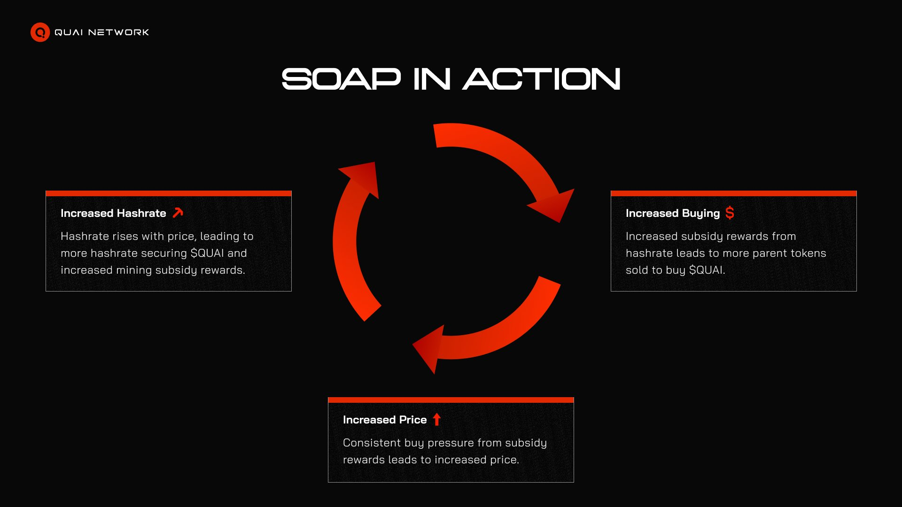

## Two Tokens, One Complete Monetary System

Most blockchains force a single token to do conflicting jobs: store of value, medium of exchange, and unit of account. Bitcoin excels as digital gold but is too volatile for everyday pricing; fiat-backed stablecoins work for payments but inherit fiat inflation and centralized custodial risk.

Quai Network solves this by purpose-designing **two complementary native tokens** anchored by Proof-of-Work and physical energy:

<CardGroup cols={2}>
  <Card title="QUAI — Programmable Hard Money" icon="gem" href="/learn/tokenomics/quai-emissions">
    EVM-compatible store-of-value asset with logarithmic mining issuance, ~93% circulating supply post-Polaris, and continuous SOAP buyback-and-burn.
  </Card>
  <Card title="Qi — The Energy Dollar (Flatcoin)" icon="bolt" href="/learn/tokenomics/flatcoins">
    World's first decentralized energy-backed flatcoin—UTXO-based digital cash whose issuance scales directly with mining energy cost.
  </Card>
</CardGroup>

Together, QUAI and Qi deliver all three pillars of sound money on a single decentralized Proof-of-Work layer:
- **Store of Value ([QUAI](/learn/tokenomics/quai-emissions)):** Scarce, supply-constrained reserve asset engineered to compound value over time.
- **Medium of Exchange ([Qi](/learn/tokenomics/qi-emissions)):** Cash-like UTXO currency with fixed denominations, native privacy properties, and energy-anchored stability.
- **Unit of Account ([Flatcoin Design](/learn/tokenomics/flatcoins)):** Pricing anchored to real-world energy—the fundamental input to both human commerce and AI computation.

## Post-Polaris Hard-Money Fundamentals

Following the **[Singularity Fork](/learn/tokenomics/protocol-upgrades#singularity-fork-march-2026)** (March 2026) and **[Polaris Fork](/learn/tokenomics/protocol-upgrades#polaris-fork-october-2026)** (October 2026), Quai permanently burned **~1.90 billion** of its original 3 billion genesis tokens—eliminating long-term insider overhang:

- **~92.8%** of QUAI supply is already circulating (`1.17B QUAI`)
- **&lt; 4% / year** genesis inflation (down from 13%) and **~4.72% / year** estimated net mining inflation after SOAP burns
- **&lt; 9% / year** total inflation including SOAP burns (down from 18%)
- **~3.7M QUAI / month** remaining unlocks (~90.4M locked genesis through early 2029)

<Frame caption="Post-Polaris QUAI supply status from supply.qu.ai">
	
</Frame>

Track real-time supply, genesis burns, lock-mining durations, and emission flows on [supply.qu.ai](https://supply.qu.ai).

## Token Names & Etymology

The token names reflect each asset's monetary role:

- **Quai (pronounced "k-why"):** Derives from the Chinese character 块, a colloquial term for money akin to "buck" or "quid" in English.
- **Qi (pronounced "chee"):** Comes from the Chinese character 气, meaning "energy" or "life force"—reflecting Qi's design as an energy-backed flatcoin whose value is tied to physical energy production.

## SOAP: Turning External Hashrate into Permanent Scarcity

**[Project SOAP](/learn/advanced-introduction/soap)** (Subsidized Open-market Acquisition Protocol) turns multi-algorithm merge-mining into continuous QUAI **buyback and burn**:

1. SHA-256 (BCH), Scrypt (LTC/DOGE), and KawPoW (RVN) miners submit AuxPoW workshares to Quai, routing 100% of parent-chain coinbase subsidies to protocol-controlled addresses.
2. SOAP converts those external subsidies into QUAI on the open market.
3. **100%** of purchased QUAI is permanently burned at [`0x0050AF0000000000000000000000000000000000`](https://explorer.qu.ai/address/0x0050AF0000000000000000000000000000000000).

The result is a protocol-level supply sink that offsets mining emissions while expanding Quai's multi-algorithm security budget.

<Frame>
	
</Frame>

## Explore Tokenomics & Live Dashboards

<CardGroup cols={2}>
  <Card title="QUAI Emissions" icon="coins" href="/learn/tokenomics/quai-emissions">
    Post-Polaris supply equation, emission curve, and SOAP burn mechanics.
  </Card>
  <Card title="What Are Flatcoins?" icon="scale-balanced" href="/learn/tokenomics/flatcoins">
    Why fiat stablecoins erode purchasing power and how Qi works as an energy flatcoin.
  </Card>
  <Card title="Protocol Upgrades" icon="code-branch" href="/learn/tokenomics/protocol-upgrades">
    Full breakdown of SOAP, Singularity (v0.51.0), and Polaris (v0.57.0).
  </Card>
  <Card title="Live Dashboards" icon="chart-line" href="https://supply.qu.ai">
    Inspect real-time metrics at supply.qu.ai and soap.qu.ai.
  </Card>
</CardGroup>
